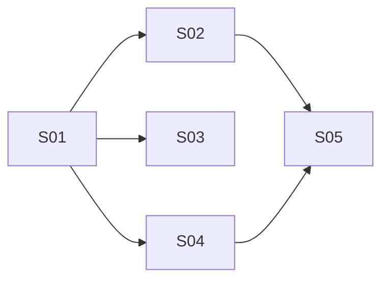

# Implementation Steps: Visitor Counter

- **Source RFF:** `.rff/visitor-counter/request-for-feature.md`
- **Date:** 2026-11-11
- **Steps:** 5 (5 slices, 0 enablers) in 3 stages

## 1. Overview
The walking skeleton is the backend write path: the `daily_visits` table plus `POST /visits`, which a `curl` call can already exercise end to end (S01). The two read endpoints (S02, S03) and the frontend visit tracker (S04) then build on it in parallel. The `/stats` page (S05) comes last, because it needs both `GET /visits/total` and the frontend `ApiVisit` client. The work spans two repositories: `growtweet-back` (S01–S03) and `growtweet-front` at `C:\Devel\growtweet-front` (S04, S05). Following the RFF's non-goal, no automated tests are added. Every step is checked by hand, and the existing backend test suite must keep passing.

## 2. Software layers
| Layer | Location / main files | Notes |
|-------|----------------------|-------|
| Data / schema | `prisma/schema.prisma`, `prisma/migrations/` | Postgres via Prisma; snake_case via `@map` / `@@map` |
| Data access (DAO) | `src/daos/prisma/*_dao.ts`, singletons in `src/daos/_setup.ts` | Services import DAOs only from `daos/_setup` |
| Models | `src/models/*.ts` | Interface + class pairs (`ILike` / `Like`) |
| Services | `src/services/*_service.ts`, `services_types.ts` | Instantiated per request; return `ServiceResponse` via `SuccessResult` |
| Endpoints | `src/controllers/*_controller.ts`, registered in `src/create_server.ts` | `express.Router`; every handler uses `processAndRespond` |
| API docs | `src/docs/swagger.json` | Hand-maintained OpenAPI 3.0.3; served at `/docs` |
| Front API client | `growtweet-front/src/api/*.ts`, `src/api/dto/*.ts` | Classes extending `ApiConnection`, one instance per call; `CommonResponse<T>` wrapper |
| Front app shell / routing | `growtweet-front/src/App.tsx`, `src/app-router.tsx` | `createBrowserRouter` + `RouterProvider`; warm-up ping in `App.tsx` |
| Front pages | `growtweet-front/src/pages/*.tsx` | styled-components; CSS variables in `src/app-style.css` |
| Tests | `tests/` (backend only) | Jest + Prisma deep mock; no new tests (non-goal), existing ones must pass |

## 3. Steps

### S01 - Count a visit with `POST /visits`

- **Type:** Slice (also the shared backend foundation)
- **Purpose:** Create the per-day visit storage and the public endpoint that records one visit. This is the thinnest end-to-end path, and the other backend endpoints build on it.
- **Behavior:** `POST /visits` (no auth) adds 1 to today's UTC row in `daily_visits`, creating the row with `count = 1` if it does not exist, through one atomic upsert. It responds with 201 and `{ success, message, data: { date: "YYYY-MM-DD", count } }`, holding the day's updated row. Swagger lists the endpoint.
- **Requirements covered:** FR-07, FR-14 (for this endpoint); data model (§7); enables FR-08, FR-09, FR-03
- **Depends on:** none
- **Prerequisites:** none (uses existing `processAndRespond`, `SuccessResult`, `PrismaClient` from `src/daos/prisma/_setup.ts`)
- **Provides:**
  - `DailyVisit` Prisma model / `daily_visits` table (`date DATE` PK, `count INT DEFAULT 0`), migration `add_daily_visits`. Others may read it through `visitDAO`.
  - `IDailyVisit` / `DailyVisit` model in `src/models/daily_visit.ts`: `{ date: string /* "YYYY-MM-DD", UTC */, count: number }`. This is the public shape of a day row; others may return it as-is.
  - `VisitDAO_Prisma` class in `src/daos/prisma/visit_dao.ts`, with method `increment(date: Date): Promise<DailyVisit>` (`date` = UTC midnight). The module also exports `toDailyVisit(row: { date: Date; count: number }): DailyVisit`, which formats the date as UTC `YYYY-MM-DD`. Others may add methods to the class and reuse `toDailyVisit`.
  - `visitDAO` singleton exported from `src/daos/_setup.ts`.
  - `VisitService` class in `src/services/visit_service.ts`, with `register(): ServiceResponseAsync<IDailyVisit>` (computes the current UTC date at 00:00 from the server clock, returns `SuccessResult(..., 201)`). Others may add methods.
  - `visit_controller` (default-exported `express.Router`) in `src/controllers/visit_controller.ts`, registered in `createApp()`, with route `POST /visits`. Others may add routes to it, with no auth middleware.
  - Swagger: tag `Visits`, plus the `"/visits"` path object with a `post` operation, and the component schema `DailyVisit` (`date` string/date, `count` integer) if the file uses components, otherwise an inline schema. Others may add operations to `"/visits"` and new `/visits/...` paths under the `Visits` tag.
- **Layers touched:**
  | Layer | Files | Change |
  |-------|-------|--------|
  | Data | `prisma/schema.prisma` | modify: add `DailyVisit` model with `@@map("daily_visits")` |
  | Data | `prisma/migrations/<timestamp>_add_daily_visits/migration.sql` | new (generated by `npx prisma migrate dev --name add_daily_visits`) |
  | Model | `src/models/daily_visit.ts` | new: `IDailyVisit` / `DailyVisit` |
  | DAO | `src/daos/prisma/visit_dao.ts` | new: `VisitDAO_Prisma.increment`, `toDailyVisit` |
  | DAO | `src/daos/_setup.ts` | modify: export `visitDAO` |
  | Service | `src/services/visit_service.ts` | new: `VisitService.register` |
  | Endpoint | `src/controllers/visit_controller.ts` | new: router + `POST /visits` |
  | Endpoint | `src/create_server.ts` | modify: `app.use(visit_controller)` |
  | Docs | `src/docs/swagger.json` | modify: `Visits` tag, `"/visits"` → `post` |
- **How to test:**
  - Automated: `npm test` still passes (no new tests, per the RFF non-goal); `npx tsc --noEmit` compiles.
  - Manual: Given an empty `daily_visits` table, when `curl -i -X POST http://localhost:3333/visits` runs, then the response is 201 with `data: { date: <today UTC>, count: 1 }`, and a second call returns `count: 2`.
  - Manual: Given the server is running, when 20 POSTs are sent concurrently (e.g. `for i in $(seq 20); do curl -s -X POST localhost:3333/visits & done; wait`), then today's `count` grows by exactly 20.
  - Manual: `/docs` shows `POST /visits` under `Visits`.
- **Notes / risks:** The migration needs a reachable DB (`DATABASE_URL`). Run `npx prisma generate` so the Jest Prisma deep mock knows the new model. Build the UTC date with `Date.UTC(y, m, d)` from `getUTC*` getters so the server's timezone never shifts the day. The RFF marks the model/table names as changeable; this plan fixes them as `DailyVisit` / `daily_visits`.

### S02 - Read the all-time total with `GET /visits/total`

- **Type:** Slice
- **Purpose:** Expose the total number of visits so the stats page (and anyone) can read it.
- **Behavior:** `GET /visits/total` (no auth) returns 200 with `data: { total }`, the sum of `count` over all rows, and `0` when the table is empty.
- **Requirements covered:** FR-08, FR-14 (for this endpoint)
- **Depends on:** S01
- **Prerequisites:** `DailyVisit` Prisma model, `VisitDAO_Prisma`, `visitDAO`, `VisitService`, `visit_controller`, Swagger `Visits` tag
- **Provides:**
  - `VisitDAO_Prisma.total(): Promise<number>` (`aggregate({ _sum: { count: true } })`, null → 0).
  - `VisitService.total(): ServiceResponseAsync<{ total: number }>`.
  - Route `GET /visits/total` returning `data: { total: number }`. Other steps may rely on this response contract.
  - Swagger path `"/visits/total"` → `get`.
- **Layers touched:**
  | Layer | Files | Change |
  |-------|-------|--------|
  | DAO | `src/daos/prisma/visit_dao.ts` | modify: add `total()` method |
  | Service | `src/services/visit_service.ts` | modify: add `total()` method |
  | Endpoint | `src/controllers/visit_controller.ts` | modify: add `GET /visits/total` route |
  | Docs | `src/docs/swagger.json` | modify: add `"/visits/total"` path |
- **How to test:**
  - Automated: `npm test` still passes; `npx tsc --noEmit` compiles.
  - Manual: Given an empty `daily_visits` table, when `curl localhost:3333/visits/total` runs, then `data` is `{ "total": 0 }`.
  - Manual: Given rows with counts 3 and 4, when the same call runs, then `data` is `{ "total": 7 }`.
  - Manual: `/docs` lists `GET /visits/total`.
- **Notes / risks:** `/visits/total` does not clash with `/visits` (there is no `/visits/:id`).

### S03 - List recent days with `GET /visits?last=N`

- **Type:** Slice
- **Purpose:** Expose per-day counts for the most recent days through the public API.
- **Behavior:** `GET /visits` (no auth) returns 200 with `data` as an array of up to `last` `{ date: "YYYY-MM-DD", count }` items, newest first, with only the days that have a row. `last` defaults to 10. A missing, non-numeric or non-integer value falls back to 10. Values below 1 become 1, and values above 2147483647 become 2147483647. The endpoint never returns 400 for `last`.
- **Requirements covered:** FR-09, FR-10, FR-14 (for this endpoint)
- **Depends on:** S01
- **Prerequisites:** `DailyVisit` Prisma model, `IDailyVisit` / `DailyVisit` model, `VisitDAO_Prisma`, `toDailyVisit`, `visitDAO`, `VisitService`, `visit_controller`, Swagger `"/visits"` path object
- **Provides:**
  - `VisitDAO_Prisma.listLatest(last: number): Promise<DailyVisit[]>` (`findMany({ orderBy: { date: 'desc' }, take: last })`, mapped with `toDailyVisit`).
  - `VisitService.list(last: number): ServiceResponseAsync<IDailyVisit[]>`, which clamps `last` to [1, 2147483647].
  - Route `GET /visits` with the optional `last` query param.
  - Swagger `get` operation on `"/visits"` with the `last` parameter.
- **Layers touched:**
  | Layer | Files | Change |
  |-------|-------|--------|
  | DAO | `src/daos/prisma/visit_dao.ts` | modify: add `listLatest()` method |
  | Service | `src/services/visit_service.ts` | modify: add `list()` with clamping |
  | Endpoint | `src/controllers/visit_controller.ts` | modify: add `GET /visits` route that parses `last` (fallback 10) |
  | Docs | `src/docs/swagger.json` | modify: add `get` to `"/visits"` |
- **How to test:**
  - Automated: `npm test` still passes; `npx tsc --noEmit` compiles.
  - Manual: Given rows for 15 days (insert them with SQL or Prisma Studio), when `curl localhost:3333/visits` runs, then it returns the 10 newest days, newest first, with `date` as `YYYY-MM-DD`.
  - Manual: `?last=0` and `?last=-5` return 1 row; `?last=abc` and `?last=2.5` return 10 rows; `?last=99999999999` returns all 15 rows with status 200.
  - Manual: Given an empty table, `GET /visits` returns `data: []`.
  - Manual: `/docs` lists `GET /visits` with the `last` parameter.
- **Notes / risks:** Uses the RFF's assumptions that non-integer `last` falls back to 10 and that "max integer" means the 32-bit signed max. Parse `last` with a strict integer check (e.g. `/^-?\d+$/`) before `Number(...)`, so `"2.5"` falls back to 10 instead of being truncated to 2. Clamp before passing the value to Prisma, because `take` must be a safe integer.

### S04 - Count page views in the SPA (visit tracker)

- **Type:** Slice
- **Purpose:** Make the frontend send `POST /visits` at most once per fixed 30-minute window per browser, on initial load and on every route change except `/stats`, without the user seeing anything.
- **Behavior:** On each page view, the tracker reads `localStorage.lastVisitAt` (epoch ms). If the key is missing, or `now - lastVisitAt >= 30 min`, and no request is pending in this tab, it calls `POST /visits`. On a 2xx response it saves `lastVisitAt` = the time of the triggering page view. On failure it does nothing visible and saves nothing. Page views inside the window, and on `/stats`, send nothing. Login and logout have no effect beyond the existing `localStorage.clear()`.
- **Requirements covered:** FR-01, FR-02, FR-03, FR-04, FR-05, FR-06, FR-12 (no counting on `/stats`)
- **Depends on:** S01
- **Prerequisites:** `POST /visits` route (returns 201 with `data: { date, count }`)
- **Provides:**
  - `ApiVisit` class in `growtweet-front/src/api/api-visit.ts` (`extends ApiConnection`, instantiated per call), with `register(): Promise<void>` calling `POST /visits`. Others may add methods.
  - `growtweet-front/src/api/dto/visit-dtos.ts` with `DailyVisitDTO = CommonResponse<{ date: string; count: number }>`. Others may append DTO types.
  - `trackPageView(pathname: string): void` in `growtweet-front/src/visit-tracker.ts`. It is internal to this step and is wired in `App.tsx`.
- **Layers touched:**
  | Layer | Files | Change |
  |-------|-------|--------|
  | Front API client | `growtweet-front/src/api/api-visit.ts` | new: `ApiVisit.register()` |
  | Front API client | `growtweet-front/src/api/dto/visit-dtos.ts` | new: `DailyVisitDTO` |
  | Front logic | `growtweet-front/src/visit-tracker.ts` | new: window check, module-level in-flight flag, try/catch around `localStorage`, skip when `pathname === '/stats'` |
  | Front app shell | `growtweet-front/src/App.tsx` | modify: a `useEffect` that calls `trackPageView(appRouter.state.location.pathname)` once and subscribes with `appRouter.subscribe(state => trackPageView(state.location.pathname))`, unsubscribing on cleanup (only call on pathname changes) |
- **How to test:**
  - Automated: none (non-goal); `npm run build` / `npx tsc --noEmit` in `growtweet-front` compiles, and `npm run lint` passes if configured.
  - Manual (DevTools Network + Application tabs): Given no `lastVisitAt`, when `/` loads, then exactly one `POST /visits` is sent and `lastVisitAt` is set after the 201.
  - Manual: Given `lastVisitAt` = now − 10 min, when navigating between `/explore` and `/home`, then no POST is sent and `lastVisitAt` is unchanged.
  - Manual: Given `lastVisitAt` = now − 31 min (edit it in DevTools), when navigating, then one POST is sent and `lastVisitAt` becomes the navigation time.
  - Manual: Given the API is stopped, when a page loads, then there is no toast or error, `lastVisitAt` is unchanged, and the next navigation (with the API back) sends the POST.
  - Manual: Given network throttling ("Slow 3G"), when navigating several times quickly, then only one POST is pending at a time.
  - Manual: Given no `lastVisitAt`, when `/stats` is opened directly, then no POST is sent and `lastVisitAt` stays absent.
  - Manual: logging in or out does not trigger a POST by itself (unless the window expired or `localStorage.clear()` removed the key).
- **Notes / risks:** `trackPageView` must ignore router state updates that do not change the pathname (e.g. navigation `loading` states), or it can rely on the window check plus the in-flight guard, which make repeated calls harmless. React `StrictMode` may run the effect twice in dev; the in-flight guard covers that. Uses the RFF assumptions that `localStorage.clear()` on logout/401 is accepted and that a 401 cannot occur on this endpoint. After a cold start, the warm-up reload in `App.tsx` re-runs the initial check, which retries a failed POST.

### S05 - Show the total on the hidden `/stats` page

- **Type:** Slice
- **Purpose:** Let the site owner see the all-time visit count at `<frontend-host>/stats`.
- **Behavior:** `/stats` is a top-level route outside `MainTemplatePage` (no NavBar, News or mobile nav), with no link anywhere in the UI. It shows `Loading...`, then `<n> total visitors` (plain integer, no thousands separator, never singular), or `Could not load visitor count.` when the request fails. The text sits on the app background, styled with the existing CSS variables.
- **Requirements covered:** FR-11, FR-13, FR-12 (the page itself changes no visit state)
- **Depends on:** S02, S04
- **Prerequisites:** `GET /visits/total` route (returns `data: { total: number }`), `ApiVisit` class, `visit-dtos.ts`
- **Provides:**
  - `ApiVisit.total(): Promise<number>` calling `GET /visits/total`.
  - `VisitTotalDTO = CommonResponse<{ total: number }>` appended to `visit-dtos.ts`.
  - `StatsPage` component in `growtweet-front/src/pages/stats-page.tsx`.
  - Top-level route `{ path: "/stats", element: <StatsPage /> }` in `appRouter`.
- **Layers touched:**
  | Layer | Files | Change |
  |-------|-------|--------|
  | Front API client | `growtweet-front/src/api/api-visit.ts` | modify: add `total()` |
  | Front API client | `growtweet-front/src/api/dto/visit-dtos.ts` | modify: append `VisitTotalDTO` |
  | Front page | `growtweet-front/src/pages/stats-page.tsx` | new: loading / value / error states |
  | Front routing | `growtweet-front/src/app-router.tsx` | modify: add top-level `/stats` route |
- **How to test:**
  - Automated: none (non-goal); `growtweet-front` builds / type-checks.
  - Manual: Given an empty `daily_visits` table, when `/stats` is opened, then `Loading...` shows briefly, then `0 total visitors`.
  - Manual: Given a total of 1, the page shows `1 total visitors`. Given a total of 12345, it shows `12345 total visitors` (no separator).
  - Manual: Given the API is stopped, when `/stats` is opened, then `Could not load visitor count.` is shown.
  - Manual: the page shows no NavBar, News or mobile nav, and no link to `/stats` exists in the UI.
  - Manual: opening `/stats` sends no `POST /visits` and does not change `lastVisitAt`.
- **Notes / risks:** Use `String(total)` (not `toLocaleString`) to meet FR-13. Avoid toasts on error; the error text is inline.

## 4. Execution stages
| Stage | Steps (parallel) | Depends on stages | Delivers |
|-------|------------------|-------------------|----------|
| 1 | S01 | - | `daily_visits` table and `POST /visits` |
| 2 | S02, S03, S04 | 1 | `GET /visits/total`, `GET /visits`, frontend counting |
| 3 | S05 | 2 | `/stats` page |

**Critical path:** S01 → S02 → S05 (S01 → S04 → S05 has the same length)

**Parallelization notes:**
- S02 and S03 both edit `src/daos/prisma/visit_dao.ts`, `src/services/visit_service.ts`, `src/controllers/visit_controller.ts` and `src/docs/swagger.json`. Each only **adds** its own method/route. In Swagger, S02 adds the new `"/visits/total"` path, and S03 adds a `get` key inside the existing `"/visits"` object. These are small additive edits in different places; expect trivial merge conflicts at most (adjacent insertions at the end of a class or file).
- S04 works in the other repository (`growtweet-front`) and touches only `App.tsx` and new files, so it never conflicts with S02/S03.
- S05 is the only step that edits `app-router.tsx`. S04 deliberately avoids the router config (it subscribes in `App.tsx`), so the two never touch the same file region. S05 only appends to `api-visit.ts` and `visit-dtos.ts`, which S04 creates.

## 5. Requirements coverage
| Requirement | Steps |
|-------------|-------|
| FR-01 page view definition | S04 |
| FR-02 localStorage, login-independent | S04 |
| FR-03 30-min check before POST | S04 |
| FR-04 fixed window | S04 |
| FR-05 save only after 2xx | S04 |
| FR-06 per-tab in-flight guard | S04 |
| FR-07 `POST /visits` atomic upsert, 201 | S01 |
| FR-08 `GET /visits/total` | S02 |
| FR-09 `GET /visits` list | S03 |
| FR-10 `last` default and clamp | S03 |
| FR-11 `/stats` page | S05 |
| FR-12 `/stats` not counted | S04 (tracker skips `/stats`), S05 (page changes no visit state) |
| FR-13 number format | S05 |
| FR-14 response wrapper | S01, S02, S03 |
| Data model (§7) | S01 |
| Swagger (§8, acceptance criteria) | S01, S02, S03 |

## 6. Shared items
| Item | Kind | Created by | Used / extended by | What others may rely on |
|------|------|-----------|--------------------|-------------------------|
| `DailyVisit` / `daily_visits` | Prisma model / table | S01 | S02, S03 | `date DATE` PK (UTC day), `count INT` |
| `IDailyVisit` / `DailyVisit` (`src/models/daily_visit.ts`) | model | S01 | S03 | `{ date: "YYYY-MM-DD", count: number }` |
| `VisitDAO_Prisma` | DAO class | S01 | S02, S03 | others add methods |
| `toDailyVisit` | function (visit_dao.ts) | S01 | S03 | maps a Prisma row to `DailyVisit`, UTC `YYYY-MM-DD` |
| `visitDAO` | singleton (`daos/_setup.ts`) | S01 | S02, S03 | only access path for services |
| `VisitService` | service class | S01 | S02, S03 | others add methods |
| `visit_controller` | Router, registered in `createApp()` | S01 | S02, S03 | others add public routes, no auth |
| `POST /visits` | route | S01 | S04 | 201, `data: { date, count }` |
| `GET /visits/total` | route | S02 | S05 | 200, `data: { total: number }` |
| `GET /visits` | route | S03 | - | 200, `data: IDailyVisit[]` |
| Swagger `Visits` tag + `"/visits"` path | API doc | S01 | S02, S03 | others add operations / `/visits/...` paths |
| `ApiVisit` (`src/api/api-visit.ts`, front) | API client class | S04 | S05 | extends `ApiConnection`; others add methods |
| `visit-dtos.ts` (front) | DTO module | S04 | S05 | others append DTO types |
| `lastVisitAt` | localStorage key (epoch ms) | S04 | - | owned by the tracker only |
| `/stats` | front route path | S05 | S04 (skips the literal path from FR-12) | path fixed by the RFF |

## 7. Assumptions and open points
- `POST /visits` returns the updated day row `{ date, count }` as `data`. The RFF only requires 201, so this is a planning choice (S01, S04).
- The table/model names `DailyVisit` / `daily_visits` are kept from the RFF (S01).
- `last` that is non-numeric or non-integer → 10, and "max integer" = 2147483647: RFF assumptions (S03).
- `localStorage` unavailable → the tracker catches the error and does not count; `localStorage.clear()` on logout/401 resetting the window is accepted; no 401 on visit endpoints: RFF assumptions (S04).
- The tracker is wired through `appRouter.subscribe` in `App.tsx` instead of a root layout route, so that `app-router.tsx` has a single owner (S05). The RFF allows either option (S04).
- The frontend repository (`C:\Devel\growtweet-front`) is currently on `main`. Create a feature branch there before S04/S05.
- The S01 migration needs a reachable Postgres (`DATABASE_URL`). Afterwards, run `npx prisma generate` so the existing Jest Prisma mock type-checks with the new model.
