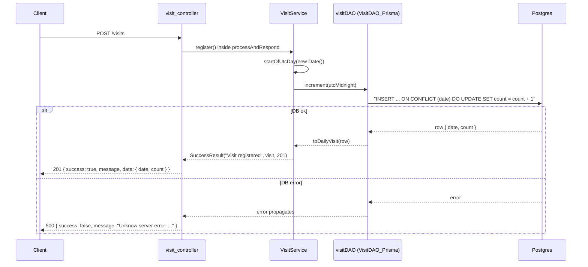

# S01 - Count a visit with `POST /visits`

- **Plan:** [plan.md](plan.md)
- **Type:** Slice (also the shared backend foundation)
- **Requirements covered:** FR-07, FR-14 (for `POST /visits`), data model (RFF §7), Swagger acceptance criterion (for `POST /visits`)
- **Prerequisites:** none. Uses the existing `processAndRespond` (`src/controllers/controller_utils.ts`), `SuccessResult` / `ServiceResponseAsync` (`src/services/services_types.ts`) and the `PrismaClient` default export of `src/daos/prisma/_setup.ts`.
- **Creates:** `DailyVisit` Prisma model / `daily_visits` table (migration `add_daily_visits`), `IDailyVisit` / `DailyVisit` model, `VisitDAO_Prisma` (with `increment`), `toDailyVisit`, `visitDAO`, `VisitService` (with `register`), `visit_controller`, route `POST /visits`, Swagger tag `Visits` + `"/visits"` path (`post`) + component schema `DailyVisit`

## 1. Goal
A public `POST /visits` adds 1 to the row of the current UTC day in `daily_visits`, creating it with `count = 1` when it does not exist, through a single atomic upsert. The response is 201:

```json
{ "success": true, "message": "Visit registered", "data": { "date": "2026-11-11", "count": 1 } }
```

`data` is the day row after the increment. `/docs` lists the endpoint under the `Visits` tag.

## 2. Context
- Layering: controllers → services → DAOs → Prisma. Services import DAOs only from `src/daos/_setup.ts` (tests mock that module).
- Existing siblings to copy: `like_controller.ts` (a default-exported `express.Router` whose handlers call `processAndRespond`), `like_service.ts` (`SuccessResult("...", data, 201)`), `like_dao.ts` (a class using `repository` from `./_setup` that maps Prisma rows to model classes), `models/like.ts` (an interface + class with constructor parameter properties).
- `createApp()` in `src/create_server.ts` registers routers with `app.use(<router>)`. `auth_controller` is the last one.
- `prisma/schema.prisma`: Postgres, Prisma `^5.10.2`; columns use `@map` where names differ. Existing tables have no `@@map`. This model uses `@@map("daily_visits")` as the RFF asks.
- `src/docs/swagger.json` is OpenAPI 3.0.3. It uses `components.schemas` (`defaultResponse`, `tweet`), a root `tags` array (`Auth`, `Likes`) and a **root-level** `"security": [{ "bearerAuth": [] }]`, so a public operation needs `"security": []`.
- TypeScript `strict: true`. `tests/` is compiled by `tsc` as well.
- Tests: Jest + `jest-mock-extended` deep mock of the Prisma client (`tests/config/prisma.mock.ts`). The RFF lists automated tests as a non-goal, so this step adds none; the existing suite must keep passing.

## 3. Structure

### 3.1 Files
| File | Change | Responsibility |
|------|--------|----------------|
| `prisma/schema.prisma` | modify | Add the `DailyVisit` model |
| `prisma/migrations/<timestamp>_add_daily_visits/migration.sql` | new (generated) | Create the `daily_visits` table |
| `src/models/daily_visit.ts` | new | `IDailyVisit` / `DailyVisit`, the public day-row shape |
| `src/daos/prisma/visit_dao.ts` | new | `VisitDAO_Prisma.increment`, `toDailyVisit` |
| `src/daos/_setup.ts` | modify | Export the `visitDAO` singleton |
| `src/services/visit_service.ts` | new | `VisitService.register` (picks the UTC day) |
| `src/controllers/visit_controller.ts` | new | Router with `POST /visits` |
| `src/create_server.ts` | modify | Register `visit_controller` |
| `src/docs/swagger.json` | modify | `Visits` tag, `"/visits"` → `post`, `DailyVisit` schema |

### 3.2 Data

`prisma/schema.prisma`: append after `model Like` (other models untouched):

```prisma
model DailyVisit {
  date  DateTime @id @db.Date // UTC calendar day
  count Int      @default(0)

  @@map("daily_visits")
}
```

Generate the migration with `npx prisma migrate dev --name add_daily_visits` (needs a reachable `DATABASE_URL`), then `npx prisma generate` if `migrate dev` did not already run it. The generated `migration.sql` must be equivalent to:

```sql
-- CreateTable
CREATE TABLE "daily_visits" (
    "date" DATE NOT NULL,
    "count" INTEGER NOT NULL DEFAULT 0,

    CONSTRAINT "daily_visits_pkey" PRIMARY KEY ("date")
);
```

- No indexes beyond the PK and no relations. No seed data.
- Down (manual; Prisma has no down migrations): `DROP TABLE "daily_visits";`, then delete the migration folder.

### 3.3 Model: `src/models/daily_visit.ts`

```ts
export interface IDailyVisit
{
    date: string;   // UTC calendar day, "YYYY-MM-DD"
    count: number;
}

export class DailyVisit implements IDailyVisit {
    constructor(
        public date: string,
        public count: number,
    )
    {}
}
```

The class has the same name as the Prisma model type `DailyVisit` from `@prisma/client`. Never import the Prisma type by name in this step; describe the row type inline (see `toDailyVisit`).

### 3.4 DAO: `src/daos/prisma/visit_dao.ts`

```ts
import { DailyVisit } from "../../models/daily_visit";
import repository from "./_setup";

/** Maps a Prisma `daily_visits` row to the public model; the date becomes UTC "YYYY-MM-DD". */
export function toDailyVisit(row: { date: Date; count: number }): DailyVisit
// body: new DailyVisit(row.date.toISOString().slice(0, 10), row.count)

export class VisitDAO_Prisma
{
    /**
     * Atomically adds 1 to the row of `date`, creating it with count 1 if missing.
     * @param date UTC midnight of the day to count (precondition; not re-normalized here).
     * @returns the row after the increment.
     */
    async increment(date: Date): Promise<DailyVisit>
    // body: const row = await repository.dailyVisit.upsert({
    //           where:  { date },
    //           create: { date, count: 1 },
    //           update: { count: { increment: 1 } },
    //       });
    //       return toDailyVisit(row);
}
```

- `toISOString().slice(0, 10)` is UTC-based, so the server timezone never shifts the formatted day. Prisma returns `@db.Date` values as `Date` at UTC midnight.
- Errors (DB down, and so on) are not caught here; they propagate.

`src/daos/_setup.ts`: add the import and the export next to the existing ones (existing lines untouched):

```ts
import { VisitDAO_Prisma } from "./prisma/visit_dao";
export const visitDAO = new VisitDAO_Prisma();
```

### 3.5 Service: `src/services/visit_service.ts`

```ts
import { visitDAO } from "../daos/_setup";
import { IDailyVisit } from "../models/daily_visit";
import { ServiceResponseAsync, SuccessResult } from "./services_types";

/** UTC midnight of the day `now` falls in (server clock). */
function startOfUtcDay(now: Date): Date
// body: new Date(Date.UTC(now.getUTCFullYear(), now.getUTCMonth(), now.getUTCDate()))

export class VisitService
{
    /** Counts one visit for the current UTC day. Resolves with 201 and the updated day row. */
    public async register(): ServiceResponseAsync<IDailyVisit>
    // body: const visit = await visitDAO.increment(startOfUtcDay(new Date()));
    //       return SuccessResult("Visit registered", visit, 201);
}
```

- `startOfUtcDay` is module-private (not exported). It is not a shared item.
- No input, no `ApiError`, no `ErrorResult`. DAO errors propagate and become 500 in `processAndRespond`.

### 3.6 Endpoint

`src/controllers/visit_controller.ts`:

```ts
import express from 'express'
import { processAndRespond } from './controller_utils';
import { VisitService } from '../services/visit_service';

const visit_controller = express.Router()
export default visit_controller;

visit_controller.post('/visits', (req, res) => {
    processAndRespond(res, async () => await (new VisitService()).register());
})
```

- No auth middleware; the request body and headers are ignored (an `authorization` header is harmless).

`src/create_server.ts`: add `import visit_controller from './controllers/visit_controller';` after the other controller imports, and `app.use(visit_controller);` after `app.use(auth_controller);`. Nothing else changes.

### 3.7 API docs: `src/docs/swagger.json`

1. In `paths`, after `"/like/{tweetId}"`, add:

```json
"/visits": {
	"post": {
		"description": "Count one visit for the current UTC day (server clock). Creates the day row with count 1 if it does not exist.",
		"tags": ["Visits"],
		"security": [],
		"parameters": [],
		"responses": {
			"201": {
				"description": "The visit was counted; returns the day row after the increment",
				"content": {
					"application/json": {
						"schema": {
							"allOf": [
								{"$ref": "#/components/schemas/defaultResponse"},
								{ "properties": { "data": { "$ref": "#/components/schemas/DailyVisit" } } }
							]
						}
					}
				}
			},
			"500": {
				"description": "Unknown server error",
				"content": {
					"application/json": {
						"schema": { "$ref": "#/components/schemas/defaultResponse" }
					}
				}
			}
		}
	}
}
```

2. In `components.schemas`, add:

```json
"DailyVisit": {
	"description": "Visit count of one UTC day",
	"type": "object",
	"properties": {
		"date": { "description": "UTC calendar day (YYYY-MM-DD)", "type": "string", "format": "date", "example": "2026-11-11" },
		"count": { "description": "Number of visits counted that day", "type": "integer", "example": 1 }
	}
}
```

3. In the root `tags` array, append `{ "name": "Visits", "description": "Endpoints related to the visitor counter" }`.

Use the file's existing tab indentation. The JSON must stay valid.

## 4. Logic flows



The day is fixed from the server's UTC clock when the request arrives. With this query shape (`where` on the unique field only, the same `date` in `create`, no nested writes), Prisma 5 on Postgres runs the upsert as one native `INSERT ... ON CONFLICT DO UPDATE`, so concurrent requests never lose counts and never fail with a unique-constraint error.

## 5. Edge cases and errors
| Case | Expected behavior |
|------|-------------------|
| No row for today yet | Row created with `count = 1`; 201, `data.count = 1` |
| Row for today exists | `count` + 1; 201 with the new count |
| N concurrent POSTs on the same UTC day | `count` grows by exactly N; every request gets 201 (no P2002 / unique-violation errors) |
| Request near midnight UTC | The server's UTC date at arrival picks the row; the server's local timezone has no effect |
| Server running with a non-UTC `TZ` | Same UTC day and the same `date` string as with `TZ=UTC` (built from `getUTC*` and formatted with `toISOString`) |
| Request with a body, query or `authorization` header | Ignored; same 201 behavior |
| DB unreachable or a query error | 500 `{ success: false, message: "Unknow server error:\n ..." }` from `processAndRespond`; nothing counted |
| `GET /visits` or other verbs | Not handled by this step (Express 404 as today) |

## 6. Tests

### 6.1 Automated
No new tests (RFF non-goal: "Automated tests. The user will check the feature by hand."). Regression only:

| Test file | Test name | Given / When / Then | Proves |
|-----------|-----------|---------------------|--------|
| all of `tests/` | existing suite | Given the regenerated Prisma client, when `npm test` runs, then every existing test passes | No regression; the Prisma deep mock accepts the new model |
| whole project | type check | When `npx tsc --noEmit` runs, then there are no errors | Signatures compile under `strict` |

Run with: `npm test` and `npx tsc --noEmit`

### 6.2 Manual
Environment: `.env` with a reachable `DATABASE_URL`, migration applied, `npm run dev` running on port 3333.

- Given an empty `daily_visits` table, when `curl -i -X POST http://localhost:3333/visits` runs, then the status is 201 and the body is `{"success":true,"message":"Visit registered","data":{"date":"<today UTC, YYYY-MM-DD>","count":1}}`. (FR-07, FR-14)
- Given the previous check, when the same call runs again, then `data.count` is 2 and `data.date` is unchanged. (FR-07)
- Given today's row has count C, when `for i in $(seq 20); do curl -s -o /dev/null -X POST localhost:3333/visits & done; wait` runs, then one more POST returns `count = C + 21` and none of the 20 got a 500. (FR-07 atomicity; acceptance criterion "two concurrent POST requests")
- Given the DB, when `SELECT * FROM daily_visits;` runs (psql or `npx prisma studio`), then there is one row per UTC day, `date` is a `DATE`, and `count` matches the API. (Data model §7)
- Given the server is started with `TZ=America/Sao_Paulo` (or any non-UTC zone) between 21:00 and 23:59 local time (00:00–02:59 UTC), when a POST is sent, then `data.date` is the UTC date (the next local calendar day). (FR-07 "current UTC date")
- Given the DB is stopped, when a POST is sent, then the status is 500 with `success: false`, and the server keeps running. (FR-14 error path)
- Given the server is running, when `http://localhost:3333/docs` is opened, then `POST /visits` appears under `Visits` with no lock icon (public), a 201 response with the `DailyVisit` schema, and a 500 response. (Swagger acceptance criterion)
- Given the existing endpoints, when `POST /auth/login` and `GET /auth/ping` are called, then they behave as before. (Regression)

### 6.3 Static checks
- `node -e "require('./src/docs/swagger.json')"` → no error (valid JSON).
- `grep -n "visit_controller" src/create_server.ts` → one import line and one `app.use(visit_controller);` line.
- `grep -n "visitDAO" src/daos/_setup.ts` → `export const visitDAO = new VisitDAO_Prisma();`
- `grep -rn "daos/prisma/visit_dao" src/services` → no output (the service imports only from `daos/_setup`).
- `grep -n '@@map("daily_visits")' prisma/schema.prisma` → one match.

## 7. Implementation order
1. Add the `DailyVisit` model to `schema.prisma`; run `npx prisma migrate dev --name add_daily_visits` (and `npx prisma generate`); check that `npm test` still passes.
2. Add `src/models/daily_visit.ts`.
3. Add `src/daos/prisma/visit_dao.ts` and export `visitDAO` from `src/daos/_setup.ts`; `npx tsc --noEmit`.
4. Add `src/services/visit_service.ts`.
5. Add `src/controllers/visit_controller.ts` and register it in `createApp()`; run the manual `curl` checks.
6. Update `src/docs/swagger.json`; check `/docs` and the JSON validity check.
7. Final run: `npm test`, `npx tsc --noEmit`, and all manual checks.

## 8. Out of scope
- No read endpoints and no other routes on `visit_controller`; no other methods on `VisitDAO_Prisma` or `VisitService`.
- No frontend changes.
- No changes to the existing models, DAOs, services, controllers, middlewares or their Swagger entries (apart from adding to `paths`, `components.schemas` and `tags`).
- No deduplication, rate limiting, IP or user tracking (RFF non-goals).
- No new automated tests (RFF non-goal).

## 9. Design notes
- **Single atomic upsert (FR-07):** a find-then-create/update pair would race and lose counts; the native `ON CONFLICT` upsert keeps the increment atomic in the database. Do not add `select`, nested writes or extra `where` fields to the upsert, or Prisma falls back to its non-atomic client-side upsert.
- **UTC handling split by responsibility:** the service decides *which* day (business rule: server clock, UTC), and the DAO only stores the `Date` it is given and formats rows (`toDailyVisit`). `startOfUtcDay` takes `now` as a parameter instead of reading the clock itself, which keeps it pure.
- **`toDailyVisit` as an exported function** (not a class method), as the contract requires, so the row-to-model mapping has one source of truth.
- **Name clash:** the model class `DailyVisit` and the Prisma type `DailyVisit` share a name; the DAO uses an inline row type to avoid an aliased import.
- **Swagger:** the root-level `security` requirement would mark the endpoint as authenticated, so the operation sets `"security": []`. The schema goes into `components.schemas` because the file already uses components.
- **Message text** `"Visit registered"` follows the short past-tense style of `like_service.ts` (`"Like created"`).
- **Trade-off:** the existing Express 500 message leaks the DB error text; this step keeps the shared `processAndRespond` behavior unchanged.
