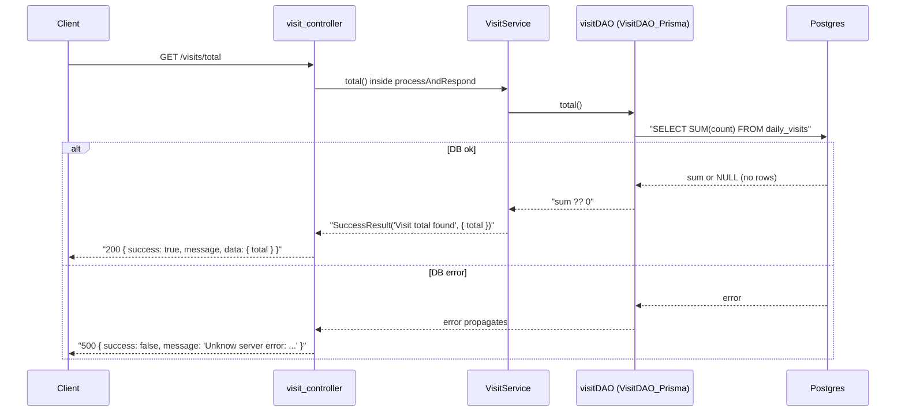

# S02 - Read the all-time total with `GET /visits/total`

- **Plan:** [plan.md](plan.md)
- **Type:** Slice
- **Requirements covered:** FR-08, FR-14 (for `GET /visits/total`), Swagger acceptance criterion (for `GET /visits/total`), acceptance criterion "Given no rows, when `GET /visits/total` is called, then it returns `total: 0`" (API part)
- **Prerequisites:** `DailyVisit` Prisma model / `daily_visits` table, `VisitDAO_Prisma`, `visitDAO`, `VisitService`, `visit_controller` (registered in `createApp()`), Swagger `Visits` tag and `"/visits"` path. Also uses the existing `processAndRespond`, `SuccessResult` / `ServiceResponseAsync` and the `repository` default export of `src/daos/prisma/_setup.ts`.
- **Creates:** `VisitDAO_Prisma.total()`, `VisitService.total()`, route `GET /visits/total` (200, `data: { total: number }`), Swagger path `"/visits/total"` → `get`

## 1. Goal
A public `GET /visits/total` returns the sum of `count` over every row of `daily_visits`:

```json
{ "success": true, "message": "Visit total found", "data": { "total": 7 } }
```

With no rows, `data` is `{ "total": 0 }`. `/docs` lists the endpoint under the `Visits` tag, without the lock icon.

## 2. Context
- Layering: controllers → services → DAOs → Prisma. `VisitService` reaches the database only through the `visitDAO` singleton imported from `src/daos/_setup.ts`.
- `src/daos/prisma/visit_dao.ts`, `src/services/visit_service.ts` and `src/controllers/visit_controller.ts` exist with one method / route each (`increment`, `register`, `POST /visits`). This step only **appends** a method or route to each; the existing members stay untouched.
- Read endpoints in this codebase return 200 through `SuccessResult(message, data)` (default status) with short messages (`"Found tweets"`, `"Tweet found"`).
- `src/docs/swagger.json` is OpenAPI 3.0.3 with a **root-level** `"security": [{ "bearerAuth": [] }]`, so a public operation sets `"security": []`. Tab indentation.
- Route matching: `visit_controller` has no `/visits/:param` route, so `/visits/total` is matched literally and cannot be shadowed.
- Tests: the RFF lists automated tests as a non-goal; this step adds none, and the existing Jest suite must keep passing.

## 3. Structure

### 3.1 Files
| File | Change | Responsibility |
|------|--------|----------------|
| `src/daos/prisma/visit_dao.ts` | modify | Add `VisitDAO_Prisma.total()` (DB sum) |
| `src/services/visit_service.ts` | modify | Add `VisitService.total()` (wraps the sum in the response) |
| `src/controllers/visit_controller.ts` | modify | Add the `GET /visits/total` route |
| `src/docs/swagger.json` | modify | Add the `"/visits/total"` path with a `get` operation |

### 3.2 DAO: `src/daos/prisma/visit_dao.ts`
Append this method at the end of the `VisitDAO_Prisma` class (after `increment`). No new imports.

```ts
    /**
     * Sum of `count` over all rows of `daily_visits`.
     * @returns the all-time number of visits; 0 when the table is empty.
     */
    async total(): Promise<number>
    // body: const result = await repository.dailyVisit.aggregate({ _sum: { count: true } });
    //       return result._sum.count ?? 0;
```

- Prisma returns `_sum.count` as `null` when there are no rows; `?? 0` maps it to 0 (FR-08 empty state).
- Errors are not caught here; they propagate.

### 3.3 Service: `src/services/visit_service.ts`
Append this method at the end of the `VisitService` class (after `register`). No new imports (`visitDAO`, `ServiceResponseAsync` and `SuccessResult` are already imported).

```ts
    /** All-time number of visits. Resolves with 200 and `{ total }`. */
    public async total(): ServiceResponseAsync<{ total: number }>
    // body: const total = await visitDAO.total();
    //       return SuccessResult("Visit total found", { total });
```

- No input, no `ApiError`, no `ErrorResult`. DAO errors propagate and become 500 in `processAndRespond`.
- The response type stays the inline `{ total: number }` the plan fixes; no model class is added for a one-field projection.

### 3.4 Endpoint: `src/controllers/visit_controller.ts`
Append after the existing `POST /visits` handler:

```ts
visit_controller.get('/visits/total', (req, res) => {
    processAndRespond(res, async () => await (new VisitService()).total());
})
```

- No auth middleware; query string, body and headers are ignored.
- `src/create_server.ts` is not touched (the router is already registered).

### 3.5 API docs: `src/docs/swagger.json`
In `paths`, right after the `"/visits"` path object, add a new path:

```json
"/visits/total": {
	"get": {
		"description": "Return the all-time number of visits (sum of the counts of every UTC day). Returns 0 when nothing was counted yet.",
		"tags": ["Visits"],
		"security": [],
		"parameters": [],
		"responses": {
			"200": {
				"description": "The all-time visit total",
				"content": {
					"application/json": {
						"schema": {
							"allOf": [
								{"$ref": "#/components/schemas/defaultResponse"},
								{
									"properties": {
										"data": {
											"type": "object",
											"properties": {
												"total": { "description": "All-time number of visits", "type": "integer", "example": 7 }
											}
										}
									}
								}
							]
						}
					}
				}
			},
			"500": {
				"description": "Unknown server error",
				"content": {
					"application/json": {
						"schema": { "$ref": "#/components/schemas/defaultResponse" }
					}
				}
			}
		}
	}
}
```

Do not change the `"/visits"` object, the `Visits` tag or `components`. Use tab indentation; the JSON must stay valid.

## 4. Logic flows



The DAO turns the SQL `NULL` of an empty table into 0, so the service and the controller never see a missing total. Any DB failure keeps the existing `processAndRespond` 500 behavior.

## 5. Edge cases and errors
| Case | Expected behavior |
|------|-------------------|
| Empty `daily_visits` table | 200, `data: { total: 0 }` (never `null` or missing) |
| One or more rows | 200, `data.total` = sum of all `count` values (e.g. 3 + 4 → 7) |
| Rows with `count = 0` | Contribute 0; the total is still correct |
| Query string, body or `authorization` header present | Ignored; same 200 response |
| DB unreachable or a query error | 500 `{ success: false, message: "Unknow server error:\n ..." }` from `processAndRespond` |
| `POST /visits/total` or other verbs | Not handled (Express 404 as today) |
| `POST /visits` | Unchanged behavior |

## 6. Tests

### 6.1 Automated
No new tests (RFF non-goal: "Automated tests. The user will check the feature by hand."). Regression only:

| Test file | Test name | Given / When / Then | Proves |
|-----------|-----------|---------------------|--------|
| all of `tests/` | existing suite | Given the current code, when `npm test` runs, then every existing test passes | No regression |
| whole project | type check | When `npx tsc --noEmit` runs, then there are no errors | `aggregate` result typing and the new signatures compile under `strict` |

Run with: `npm test` and `npx tsc --noEmit`

### 6.2 Manual
Environment: `.env` with a reachable `DATABASE_URL`, migrations applied, `npm run dev` running on port 3333.

- Given an empty `daily_visits` table (`DELETE FROM daily_visits;`), when `curl -i http://localhost:3333/visits/total` runs, then the status is 200 and the body is `{"success":true,"message":"Visit total found","data":{"total":0}}`. (FR-08 empty state, FR-14, acceptance criterion "no rows → total: 0")
- Given rows with counts 3 and 4 (`INSERT INTO daily_visits (date, count) VALUES ('2026-11-01', 3), ('2026-11-02', 4);`), when the same call runs, then `data` is `{ "total": 7 }`. (FR-08 sum)
- Given the previous state, when `curl -s -X POST localhost:3333/visits` runs and then `GET /visits/total` again, then `data.total` is 8. (FR-08 reflects new visits; `POST /visits` regression)
- Given the call is sent with `-H "authorization: Bearer invalid"`, then the response is still 200 with the total. (Public endpoint, no auth)
- Given the DB is stopped, when `GET /visits/total` runs, then the status is 500 with `success: false`, and the server keeps running. (FR-14 error path)
- Given the server is running, when `http://localhost:3333/docs` is opened, then `GET /visits/total` appears under `Visits` with no lock icon, a 200 response whose `data` has an integer `total`, and a 500 response; `POST /visits` is still listed. (Swagger acceptance criterion)

### 6.3 Static checks
- `node -e "require('./src/docs/swagger.json')"` → no error (valid JSON).
- `grep -n "'/visits/total'" src/controllers/visit_controller.ts` → one `visit_controller.get('/visits/total', ...)` line.
- `grep -n "_sum" src/daos/prisma/visit_dao.ts` → one match inside `total()`.
- `grep -rn "daos/prisma/visit_dao" src/services` → no output (the service still imports only from `daos/_setup`).

## 7. Implementation order
1. Add `VisitDAO_Prisma.total()`; `npx tsc --noEmit`.
2. Add `VisitService.total()`.
3. Add the `GET /visits/total` route; run the manual `curl` checks.
4. Add the `"/visits/total"` path to `swagger.json`; run the JSON validity check and open `/docs`.
5. Final run: `npm test`, `npx tsc --noEmit`, and all manual checks.

## 8. Out of scope
- Does not change `increment`, `register`, `POST /visits`, `toDailyVisit`, the models, the schema or `create_server.ts`.
- Does not add any per-day listing, query parameters or other routes; does not add a `get` operation to the `"/visits"` Swagger path.
- No frontend changes.
- No caching of the total, no deduplication, rate limiting, IP or user tracking (RFF non-goals).
- No new automated tests (RFF non-goal).

## 9. Design notes
- **Sum in the database:** `aggregate({ _sum })` runs a single `SUM` query instead of loading every row, as the RFF data model specifies.
- **Null handling in the DAO:** the DAO contract is "a number, 0 when empty", so the `null → 0` rule lives in one place and callers never deal with `null`.
- **No new model type:** `{ total: number }` is a one-field response used only here; a dedicated model class would be speculative (YAGNI). The Swagger response describes it inline for the same reason, instead of adding a component schema.
- **Message text** `"Visit total found"` follows the style of existing read responses (`"Tweet found"`).
- **Trade-off:** Postgres `SUM(INTEGER)` is a `bigint`; Prisma maps it to a JS `number`, which is exact up to 2^53, far beyond any realistic visit count.
- **Trade-off:** the existing 500 message leaks the DB error text; this step keeps the shared `processAndRespond` behavior unchanged.
