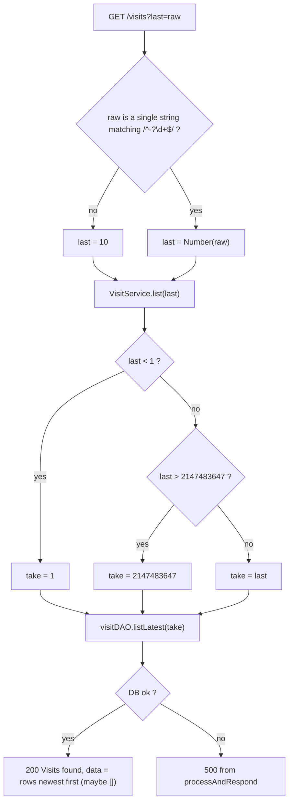

# S03 - List recent days with `GET /visits?last=N`

- **Plan:** [plan.md](plan.md)
- **Type:** Slice
- **Requirements covered:** FR-09, FR-10, FR-14 (for `GET /visits`), Swagger acceptance criterion (for `GET /visits`)
- **Prerequisites:** `DailyVisit` Prisma model / `daily_visits` table, `IDailyVisit` / `DailyVisit` model (`src/models/daily_visit.ts`), `VisitDAO_Prisma` (`src/daos/prisma/visit_dao.ts`), `toDailyVisit`, `visitDAO` (`src/daos/_setup.ts`), `VisitService` (`src/services/visit_service.ts`), `visit_controller` (`src/controllers/visit_controller.ts`, registered in `createApp()`), Swagger `Visits` tag, `"/visits"` path object and `#/components/schemas/DailyVisit`. Also the existing `processAndRespond`, `SuccessResult` / `ServiceResponseAsync`.
- **Creates:** `VisitDAO_Prisma.listLatest`, `VisitService.list`, route `GET /visits` (query param `last`), Swagger `get` operation on `"/visits"`

## 1. Goal
A public `GET /visits` returns the most recent day rows, newest first, with only days that have a row (no zero-filled gaps):

```json
{ "success": true, "message": "Visits found", "data": [ { "date": "2026-11-11", "count": 7 }, { "date": "2026-11-09", "count": 3 } ] }
```

- `last` defaults to 10. A missing, empty, non-numeric or non-integer value (for example `abc`, `2.5`, `1e3`, `+5`, repeated `last` keys) falls back to 10.
- An integer below 1 becomes 1; an integer above 2147483647 becomes 2147483647.
- `last` never causes a 400. An empty table returns `data: []`.
- `/docs` lists `GET /visits` under `Visits` with the `last` parameter.

## 2. Context
- Layering: controllers → services → DAOs → Prisma; the service imports only `visitDAO` from `src/daos/_setup.ts`.
- `visit_controller.ts` is a default-exported `express.Router` whose handlers call `processAndRespond(res, async () => await (new VisitService()).<method>())`. It already has `POST /visits`; no auth middleware is used on it.
- `visit_dao.ts` exports `toDailyVisit(row: { date: Date; count: number }): DailyVisit` and the class `VisitDAO_Prisma`, which uses `repository` (the `PrismaClient` from `./_setup`). The model class `DailyVisit` shares its name with the Prisma type; do not import the Prisma type by name.
- Existing query-param parsing (`tweet_controller.ts`) uses `Number(req.query.page ?? 1)` with no validation. This step needs a stricter parse (FR-10), so it does not copy that pattern.
- `req.query.last` is typed `string | string[] | ParsedQs | ParsedQs[] | undefined` (Express 4 + `qs`).
- `src/docs/swagger.json`: OpenAPI 3.0.3, tab indentation, root-level `"security": [{ "bearerAuth": [] }]`, so public operations set `"security": []`. The `"/visits"` path object already holds a `post` operation.
- Success message style: `"Found tweets"`, `"Tweet found"`, `"User found"`. This step uses `"Visits found"`.
- Tests: Jest with a Prisma deep mock. Automated tests are an RFF non-goal; this step adds none, and the existing suite must keep passing.

## 3. Structure

### 3.1 Files
| File | Change | Responsibility |
|------|--------|----------------|
| `src/daos/prisma/visit_dao.ts` | modify | Add `VisitDAO_Prisma.listLatest` (query + mapping) |
| `src/services/visit_service.ts` | modify | Add `VisitService.list` (clamping rule) |
| `src/controllers/visit_controller.ts` | modify | Add `GET /visits` route and the `last` parsing (fallback 10) |
| `src/docs/swagger.json` | modify | Add `get` to the `"/visits"` path object |

### 3.2 DAO: `src/daos/prisma/visit_dao.ts`
Add one method at the end of `VisitDAO_Prisma`. `toDailyVisit`, the imports and the existing methods stay unchanged.

```ts
/**
 * Returns up to `last` day rows, newest date first. Days without a row are not included.
 * @param last positive safe integer (precondition; the caller clamps it).
 */
async listLatest(last: number): Promise<DailyVisit[]>
// body: const rows = await repository.dailyVisit.findMany({
//           orderBy: { date: 'desc' },
//           take: last,
//       });
//       return rows.map(toDailyVisit);
```

- No `select`: the table has only `date` and `count`, which is exactly what `toDailyVisit` needs.
- Errors propagate (no try/catch).

### 3.3 Service: `src/services/visit_service.ts`
Add module-level constants next to the existing module-private helper, and one method at the end of `VisitService`. Existing members stay unchanged.

```ts
/** Bounds of the `last` parameter of the day list (FR-10; the max is the Postgres INT max). */
const MIN_LIST_DAYS = 1;
const MAX_LIST_DAYS = 2147483647;

export class VisitService
{
    // ...existing methods...

    /**
     * Lists the most recent day rows, newest first.
     * @param last requested number of days; any integer, clamped to [MIN_LIST_DAYS, MAX_LIST_DAYS].
     * @returns 200 with "Visits found" and the rows (an empty array when there are none).
     */
    public async list(last: number): ServiceResponseAsync<IDailyVisit[]>
    // body: const take = Math.min(Math.max(last, MIN_LIST_DAYS), MAX_LIST_DAYS);
    //       const visits = await visitDAO.listLatest(take);
    //       return SuccessResult("Visits found", visits);
}
```

- Precondition: `last` is an integer or `±Infinity` (the controller guarantees it). Out-of-range values are the service's job; non-integers are not.
- No `ApiError`, no `ErrorResult`: `last` never produces a 400. DAO errors propagate and become 500 in `processAndRespond`.
- The constants are module-private (not exported); they are not shared items.

### 3.4 Endpoint: `src/controllers/visit_controller.ts`
Add a module-private parser and constant, and the route after the existing `POST /visits` route. The existing route and imports stay unchanged.

```ts
/** Value of `last` when it is missing or not an integer (FR-10). */
const DEFAULT_LIST_DAYS = 10;
const INTEGER_PATTERN = /^-?\d+$/;

/** Parses the raw `last` query value; anything that is not a single integer string gives DEFAULT_LIST_DAYS. */
function parseLastParam(raw: unknown): number
// body: return (typeof raw === 'string' && INTEGER_PATTERN.test(raw)) ? Number(raw) : DEFAULT_LIST_DAYS;

visit_controller.get('/visits', (req, res) => {
    processAndRespond(res, async () => await (new VisitService()).list(parseLastParam(req.query.last)));
})
```

- The strict pattern runs before `Number(...)`, so `"2.5"` falls back to 10 instead of becoming 2, and `"1e3"`, `"0x10"`, `" 5"` and `""` also fall back to 10.
- A string of digits too large for a double (over 308 digits) gives `Infinity`, which the service clamps to 2147483647.
- `visit_controller` has no parameterized `/visits/:param` route, so route order does not matter.
- No auth middleware; headers and body are ignored.

### 3.5 API docs: `src/docs/swagger.json`
Inside the existing `"/visits"` path object, add a `get` key next to `post` (the `post` operation stays unchanged; keep tab indentation and valid JSON):

```json
"get": {
	"description": "List the visit counts of the most recent UTC days that have visits, newest first. Days without visits are not included.",
	"tags": ["Visits"],
	"security": [],
	"parameters": [
		{
			"name": "last",
			"in": "query",
			"required": false,
			"description": "Maximum number of days to return. Defaults to 10; a missing or non-integer value is treated as 10. Values below 1 become 1 and values above 2147483647 become 2147483647. Never causes a 400.",
			"schema": { "type": "integer", "default": 10, "example": 10 }
		}
	],
	"responses": {
		"200": {
			"description": "The most recent day rows, newest first (an empty array when there are none)",
			"content": {
				"application/json": {
					"schema": {
						"allOf": [
							{"$ref": "#/components/schemas/defaultResponse"},
							{ "properties": { "data": { "type": "array", "items": { "$ref": "#/components/schemas/DailyVisit" } } } }
						]
					}
				}
			}
		},
		"500": {
			"description": "Unknown server error",
			"content": {
				"application/json": {
					"schema": { "$ref": "#/components/schemas/defaultResponse" }
				}
			}
		}
	}
}
```

- No `minimum` / `maximum` in the schema: those would make Swagger UI reject values the API accepts and clamps; the clamp is documented in the description instead.

## 4. Logic flows



The controller only decides between a parsed integer and the default; the service only clamps the range; the DAO only queries and maps. Every input reaches a 200 except a database failure, which gives the existing 500.

## 5. Edge cases and errors
| Case | Expected behavior |
|------|-------------------|
| No `last` | 10 newest rows (fewer if fewer exist) |
| `?last=` (empty), `?last=abc`, `?last=2.5`, `?last=1e3`, `?last=+5`, `?last=%205` | Treated as 10 |
| `?last=5&last=7` (array) or `?last[a]=1` (object) | Treated as 10 |
| `?last=0`, `?last=-5`, `?last=-0` | Treated as 1: newest row only |
| `?last=007` | Treated as 7 |
| `?last=99999999999` or a longer digit string | Clamped to 2147483647: all rows, 200 |
| Digit string over 308 characters (`Number` → `Infinity`) | Clamped to 2147483647: all rows, 200 |
| Empty table | 200, `data: []` |
| Gaps between days | Only existing rows are returned; no zero-filled days |
| Request with `authorization` header or a body | Ignored; same behavior |
| DB unreachable or query error | 500 `{ success: false, message: "Unknow server error:\n ..." }` |
| `POST /visits` and other existing endpoints (e.g. `GET /auth/ping`) | Behave as before |

## 6. Tests

### 6.1 Automated
No new tests (RFF non-goal: "Automated tests. The user will check the feature by hand."). Regression only:

| Test file | Test name | Given / When / Then | Proves |
|-----------|-----------|---------------------|--------|
| all of `tests/` | existing suite | Given the code of this step, when `npm test` runs, then every existing test passes | No regression |
| whole project | type check | When `npx tsc --noEmit` runs, then there are no errors | Signatures compile under `strict` |

Run with: `npm test` and `npx tsc --noEmit`

### 6.2 Manual
Environment: `.env` with a reachable `DATABASE_URL`, migrations applied, `npm run dev` on port 3333. Seed data with SQL (psql or `npx prisma studio`), for example:
`INSERT INTO daily_visits (date, count) SELECT d::date, (random()*20)::int + 1 FROM generate_series(CURRENT_DATE - 14, CURRENT_DATE, '1 day') d;` (15 days).

- Given an empty `daily_visits` table, when `curl -i localhost:3333/visits` runs, then the status is 200 and the body is `{"success":true,"message":"Visits found","data":[]}`. (FR-09 empty state, FR-14)
- Given 15 seeded days, when `curl localhost:3333/visits` runs, then `data` has 10 items, the newest date first, strictly descending, each `{ "date": "YYYY-MM-DD", "count": <n> }` matching the table. (FR-09, FR-10 default; acceptance criterion "rows for 15 days")
- Given 15 seeded days, when `?last=3` is used, then the 3 newest days are returned. (FR-09)
- Given 15 seeded days, when `?last=0` and `?last=-5` are used, then each returns 1 row (the newest day), status 200. (FR-10; acceptance criterion)
- Given 15 seeded days, when `?last=abc`, `?last=2.5` and `?last=` are used, then each returns 10 rows, status 200. (FR-10 fallback)
- Given 15 seeded days, when `?last=99999999999` is used, then all 15 rows are returned with status 200. (FR-10 clamp; acceptance criterion)
- Given 15 seeded days, when `?last=5&last=7` is used, then 10 rows are returned, status 200. (FR-10 never 400)
- Given rows only for 2026-11-01 and 2026-11-05, when `GET /visits` runs, then exactly those 2 rows are returned, `2026-11-05` first, with no zero-filled days. (FR-09)
- Given the server runs with a non-UTC `TZ` (e.g. `TZ=America/Sao_Paulo`), when `GET /visits` runs, then each `date` equals the stored `DATE` value (no off-by-one day). (FR-09 date format)
- Given the DB is stopped, when `GET /visits` runs, then the status is 500 with `success: false`, and the server keeps running. (FR-14 error path)
- Given the server is running, when `/docs` is opened, then `GET /visits` appears under `Visits` with no lock icon, an optional integer `last` query parameter (default 10), a 200 response with an array of `DailyVisit`, and a 500 response; `POST /visits` is still listed. (Swagger acceptance criterion)
- Given the existing endpoints, when `POST /visits` and `GET /auth/ping` are called, then they behave as before. (Regression)

### 6.3 Static checks
- `node -e "require('./src/docs/swagger.json')"` → no error (valid JSON).
- `node -e "const s=require('./src/docs/swagger.json');console.log(Object.keys(s.paths['/visits']).sort().join(','))"` → `get,post`.
- `grep -n "visit_controller.get('/visits'" src/controllers/visit_controller.ts` → one match.
- `grep -rn "daos/prisma/visit_dao" src/services` → no output.
- `grep -n "2147483647" src/services/visit_service.ts` → one match (the `MAX_LIST_DAYS` constant).

## 7. Implementation order
1. Add `listLatest` to `VisitDAO_Prisma`; `npx tsc --noEmit`.
2. Add `MIN_LIST_DAYS`, `MAX_LIST_DAYS` and `VisitService.list`; `npx tsc --noEmit`.
3. Add `DEFAULT_LIST_DAYS`, `INTEGER_PATTERN`, `parseLastParam` and the `GET /visits` route; run the manual `curl` checks.
4. Add the `get` operation to `"/visits"` in `swagger.json`; run the JSON checks and open `/docs`.
5. Final run: `npm test`, `npx tsc --noEmit`, and all manual checks.

## 8. Out of scope
- Does not change `POST /visits` or other existing routes, `toDailyVisit`, the `DailyVisit` model, the schema or migrations.
- Does not change existing `VisitDAO_Prisma` / `VisitService` members or the `post` operation and other entries in `swagger.json`.
- No pagination, date-range filters or zero-filled days; no frontend changes (RFF non-goal: per-day data in the UI).
- No changes to `processAndRespond` or other controllers.
- No new automated tests (RFF non-goal).

## 9. Design notes
- **Responsibility split for `last` (FR-10):** the controller turns the raw HTTP value into a number or the default (transport concern), the service owns the business range [1, 2147483647], and the DAO trusts its input. Each rule has one home and one constant.
- **Strict integer pattern before `Number`:** `Number("2.5")`, `Number("1e3")` and `Number(" 5")` all succeed, and `parseInt("2.5")` gives 2; the regex is the only way to send every non-integer to the default as the RFF assumes.
- **Clamp, never reject:** no `ApiError` path exists for `last`, so the endpoint cannot return 400. Clamping also keeps `take` a safe integer, which Prisma requires.
- **Rejected:** Swagger `minimum`/`maximum` on `last` (Swagger UI would block values the API accepts); `select` on `findMany` (adds nothing for a two-column table).
- **Message** `"Visits found"` follows the existing `"Found tweets"` / `"Tweet found"` / `"User found"` style.
