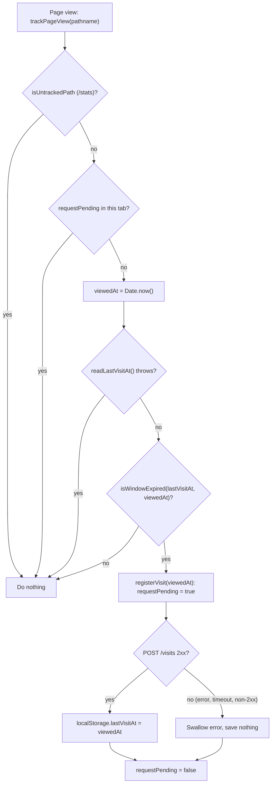
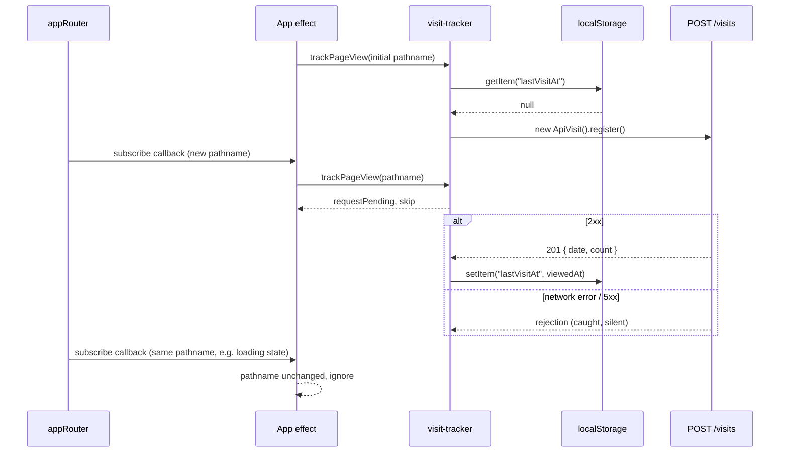

# S04 - Count page views in the SPA (visit tracker)

- **Plan:** [plan.md](plan.md)
- **Type:** Slice
- **Requirements covered:** FR-01, FR-02, FR-03, FR-04, FR-05, FR-06, FR-12 (the tracker does not count `/stats`); acceptance criteria 1 to 5 of RFF §10 (frontend side)
- **Prerequisites:** `POST /visits` route (public, returns 201 with `data: { date, count }` in the `{ success, message, data }` wrapper)
- **Creates:** `ApiVisit` (`growtweet-front/src/api/api-visit.ts`, with `register()`), `visit-dtos.ts` (`growtweet-front/src/api/dto/visit-dtos.ts`, with `DailyVisitDTO`), localStorage key `lastVisitAt`

All paths below are relative to the frontend repository `C:\Devel\growtweet-front` (branch `visitor-count`).

## 1. Goal
Each browser sends `POST /visits` at most once per fixed 30-minute window. The check runs on the SPA's initial load and on every route change, except on `/stats`. The window starts at the page view that was counted, and later page views do not extend it. The timestamp is saved in `localStorage.lastVisitAt` (epoch ms) only after a 2xx response. Failures are silent, and the next page view retries. Each tab has at most one pending `POST /visits`. Users see no UI change, no toast and no console error from the tracker.

## 2. Context
- React 18 + Vite + TypeScript (`strict`, `noUnusedLocals`, `noUnusedParameters`), react-router-dom 6.21.3 (`@remix-run/router` 1.14.2), axios. There is no test suite. `npm run lint` fails on any warning (`eslint:recommended`, `@typescript-eslint/recommended`, `react-hooks`, `react-refresh`).
- `src/main.tsx` renders `<App />` without `StrictMode`, so effects run once (the design is safe if `StrictMode` is added later; see §5).
- `src/App.tsx` holds the warm-up ping (`new ApiAuth().ping()` in a `useEffect`, page reload after a slow start) and renders `<RouterProvider router={appRouter} />`. `appRouter` (`src/app-router.tsx`) is a module-level `createBrowserRouter(...)`, so `appRouter.state.location` is available before the first render, and `appRouter.subscribe(fn: (state: RouterState) => void): () => void` reports every state change (navigation states and committed locations).
- API clients (`api-auth.ts`, `api-tweet.ts`) extend `ApiConnection`, call `super()` in an explicit constructor, use `super.get/post(...)` and are created per call. `ApiConnection`'s constructor reads `localStorage.getItem('token')`, so creating any client can throw when storage is blocked. `post(url, data?)` rejects on non-2xx and network errors. On a 401 it calls `localStorage.clear()` and redirects to `/login`.
- DTO files (`src/api/dto/*-dtos.ts`) import `CommonResponse` from `./common-response` and export `type XxxDTO = CommonResponse<...>`.
- Code style: 4-space indent, double quotes in `src/api`, Allman braces for class members.
- Logout (`ApiAuth.unlogUser`) removes only `user` and `token`, so `lastVisitAt` survives logout. The 401 handler's `localStorage.clear()` removes it (accepted by the RFF).

## 3. Structure

### 3.1 Files
| File | Change | Responsibility |
|------|--------|----------------|
| `src/api/dto/visit-dtos.ts` | new | Response type of `POST /visits` |
| `src/api/api-visit.ts` | new | `ApiVisit` HTTP client for the visit endpoints |
| `src/visit-tracker.ts` | new | Page-view rule: `/stats` skip, 30-minute window, in-flight guard, `lastVisitAt` storage |
| `src/App.tsx` | modify | Feed the initial location and every pathname change to `trackPageView` |

### 3.2 Front API client

`src/api/dto/visit-dtos.ts`:

```ts
import { CommonResponse } from "./common-response";

export type DailyVisitDTO = CommonResponse<{ date: string; count: number }>;
```

`date` is the UTC day `"YYYY-MM-DD"`. Other DTO types may be appended to this file later; nothing else goes in it in this step.

`src/api/api-visit.ts`:

```ts
import { AxiosResponse } from "axios";
import { ApiConnection } from "./api-connection";
import { DailyVisitDTO } from "./dto/visit-dtos";

export class ApiVisit extends ApiConnection
{
    constructor()
    {
        super();
    }

    /** Counts one visit (POST /visits). Resolves on 2xx; rejects on any other status or a network error. */
    async register() : Promise<void>
    {
        await (super.post('/visits') as Promise<AxiosResponse<DailyVisitDTO>>);
    }
}
```

`register()` does not catch errors (the caller decides what a failure means) and ignores the response body. The cast only documents the response contract. Do not bind the response to an unused local, because `noUnusedLocals` would reject it.

### 3.3 Front logic: `src/visit-tracker.ts`

```ts
import { ApiVisit } from "./api/api-visit";

const LAST_VISIT_KEY = "lastVisitAt";
const VISIT_WINDOW_MS = 30 * 60 * 1000;
const UNTRACKED_PATH = "/stats";

/** True while this tab has a POST /visits pending (FR-06). Module state = one flag per tab. */
let requestPending = false;

/**
 * Handles one page view (FR-01). Sends POST /visits when the path is tracked, no request is
 * pending in this tab and the 30-minute window has expired (FR-03, FR-04). Never throws.
 */
export function trackPageView(pathname: string): void

/** `/stats`, `/stats/`, `/STATS` (react-router matches paths case-insensitively and ignores a trailing slash). */
function isUntrackedPath(pathname: string): boolean
// body: pathname.replace(/\/+$/, "").toLowerCase() === UNTRACKED_PATH

/** Reads lastVisitAt; null when missing or not a finite number. May throw when storage is blocked. */
function readLastVisitAt(): number | null

/** True when there is no stored visit, the stored one is 30+ minutes old, or it lies in the future. */
function isWindowExpired(lastVisitAt: number | null, now: number): boolean
// body: lastVisitAt === null || now < lastVisitAt || now - lastVisitAt >= VISIT_WINDOW_MS

/** Sends the POST and saves viewedAt after a 2xx. Swallows every error. Owns the in-flight flag. */
async function registerVisit(viewedAt: number): Promise<void>
```

Behavior of `trackPageView(pathname)`, in order:
1. If `isUntrackedPath(pathname)` → return (no storage read or write, FR-12).
2. If `requestPending` → return (FR-06).
3. `const viewedAt = Date.now()`. This is the time of the page view, which will be saved (FR-05).
4. `try { lastVisitAt = readLastVisitAt(); } catch { return; }`: if storage is unavailable, nothing is counted.
5. If `!isWindowExpired(lastVisitAt, viewedAt)` → return (FR-03, FR-04).
6. `void registerVisit(viewedAt);` (fire and forget; it never rejects).

`registerVisit(viewedAt)`:
- Sets `requestPending = true` synchronously, before its first `await`, so a second `trackPageView` in the same tick is already blocked.
- `try { await new ApiVisit().register(); localStorage.setItem(LAST_VISIT_KEY, String(viewedAt)); } catch { /* silent: retry on the next page view (FR-05) */ } finally { requestPending = false; }`
- `new ApiVisit()` is created inside the `try` because its constructor reads `localStorage`.
- The `catch` block must contain the comment (ESLint `no-empty` rejects an empty block). There is no `console` output and no toast.

`readLastVisitAt()`: `const raw = localStorage.getItem(LAST_VISIT_KEY); if (raw === null) return null; const value = Number(raw); return Number.isFinite(value) ? value : null;`

Only `trackPageView` is exported. The module does not import `ApiAuth` or read the logged-in user (FR-02).

### 3.4 Front app shell: `src/App.tsx`

- Add `import { trackPageView } from './visit-tracker';` next to the existing imports.
- Add a **second, separate** `useEffect` inside `App`, after the warm-up effect. The warm-up effect, the toast state and the JSX stay untouched.

```tsx
useEffect(() => {
    let lastPathname = appRouter.state.location.pathname;
    trackPageView(lastPathname);                       // initial load

    return appRouter.subscribe((state) => {            // returns the unsubscribe function
        const { pathname } = state.location;
        if (pathname === lastPathname)
            return;                                    // navigation "loading" states, same-path navigations
        lastPathname = pathname;
        trackPageView(pathname);
    });
}, []);
```

The dependency array is `[]`. `appRouter` is a module import, so `react-hooks/exhaustive-deps` does not ask for it.

## 4. Logic flows



Every page view goes through these checks. The window is measured from the stored timestamp, so views inside it never change the timestamp (fixed window). A failed or rejected request leaves storage untouched, so the next page view retries.



The App effect turns router state changes into page views (initial location plus each pathname change). The tracker serializes requests per tab with the module flag.

## 5. Edge cases and errors
| Case | Expected behavior |
|------|-------------------|
| No `lastVisitAt` (first visit, or after the 401 handler's `localStorage.clear()`) | One `POST /visits`; `lastVisitAt` = time of that page view after the 2xx |
| `now - lastVisitAt < 30 min` | No request; `lastVisitAt` unchanged (FR-04) |
| `now - lastVisitAt` exactly 30 min or more | One request (`>=`, FR-03) |
| `lastVisitAt` not a number (e.g. edited to `abc`) | Treated as missing, so it counts and is overwritten after a 2xx |
| `lastVisitAt` in the future (clock moved back, manual edit) | Treated as expired, so it counts. This prevents a window that never ends |
| `POST /visits` fails (network error, blocked request, timeout, 5xx) | The tracker adds no toast and no error text and logs nothing to the console; nothing is saved; the next page view retries. A hanging request blocks only this tab until axios settles it (no client timeout is added). When the whole backend is down, the existing warm-up toast from `App.tsx` still appears after 4 s; that toast is not caused by the tracker |
| 401 from `POST /visits` | Not expected (public endpoint); the existing `ApiConnection` handler would clear storage and redirect. No special handling |
| Navigation while a POST is pending | No second POST in that tab (FR-06); that view is not queued |
| Two tabs counting at the same moment | Both may POST (accepted by the RFF) |
| `localStorage` blocked / throwing on read | Nothing counted, no request, no error escapes `trackPageView`; the page keeps working. (If storage is blocked for the whole site, existing code that reads `localStorage`, such as `ApiConnection` in the warm-up ping, can fail on its own; that is outside this step) |
| `localStorage.setItem` throws after a 2xx | Error swallowed; the visit was counted but not saved, so the next view counts again (rare, accepted) |
| Path `/stats`, `/stats/` or `/STATS` (initial load or navigation) | No request, no storage read or write (FR-12) |
| Navigating away from `/stats` to another route | Normal check runs (that page view counts if the window expired) |
| Router emits states without a pathname change (navigation `loading`/`idle`, same-path link) | Ignored by the App effect |
| `/profile/1` → `/profile/2` | Pathname changes, so it is a page view (FR-01) |
| Login (`navigate('/')`), logout (`navigate(0)` reload) | Treated as ordinary page views or reloads; login state is never read (FR-02) |
| Warm-up reload after a cold start | The module state resets and the initial check runs again, retrying a failed POST |
| React `StrictMode` (if enabled later) double-runs the effect | The first subscription is unsubscribed on cleanup; the second initial call is blocked by `requestPending` or by the saved window |

## 6. Tests

### 6.1 Automated
The frontend has no test suite, and the RFF lists automated tests as a non-goal, so this step adds none. Build and lint gates:

| Test file | Test name | Given / When / Then | Proves |
|-----------|-----------|---------------------|--------|
| whole frontend | type check + build | When `npm run build` runs in `growtweet-front`, then `tsc` and `vite build` succeed | Signatures compile under `strict` / `noUnusedLocals` |
| whole frontend | lint | When `npm run lint` runs, then there are 0 errors and 0 warnings | Hooks deps, no empty blocks, no unused imports |

Run with: `npm run build && npm run lint` (in `C:\Devel\growtweet-front`)

### 6.2 Manual
Environment: backend running locally on port 3333 with `POST /visits` available; `npm run dev` in `growtweet-front`; Chrome DevTools open on the Network tab (filter `visits`) and on Application → Local Storage. To set a timestamp, run this in the console: `localStorage.setItem('lastVisitAt', String(Date.now() - N*60*1000))`.

- Given no `lastVisitAt`, when `/` is loaded, then exactly one `POST /visits` is sent, it returns 201, and `lastVisitAt` then holds a ms timestamp from the load time (not the response time; compare with the request start time). (FR-01, FR-03, FR-05; AC 1)
- Given no `lastVisitAt`, when `/login` is loaded directly, then one POST is sent (non-layout routes count). (FR-01)
- Given `lastVisitAt` = now − 10 min, when navigating `/explore` → `/home` → a profile → a reply page, then no POST is sent and `lastVisitAt` is unchanged. Repeat with now − 29 min. (FR-03, FR-04; AC 2)
- Given `lastVisitAt` = now − 31 min, when navigating once, then one POST is sent and `lastVisitAt` becomes the navigation time. Navigating again sends nothing. (FR-03, FR-04; AC 3)
- Given the backend is running, no `lastVisitAt`, and DevTools → Network → right-click → "Block request URL" with the pattern `*/visits` enabled (Network request blocking panel), when a page loads and then two more routes are visited, then each view's `POST /visits` shows as blocked in Network, no toast or error text appears (the backend is up, so the warm-up toast does not show either), the console has no error logged by the tracker (the browser's own "blocked" line is fine), and `lastVisitAt` stays absent. Given the block is then turned off, when navigating once more, then the POST returns 201 and `lastVisitAt` is set. (FR-05; AC 4; §5 "`POST /visits` fails")
- Given no `lastVisitAt` and Network throttling "Slow 3G", when navigating quickly between 3 or 4 routes while the first POST is pending, then only one `POST /visits` appears. (FR-06; AC 5)
- Given no `lastVisitAt`, when `/stats` is opened directly (also try `/stats/`), then no POST is sent and `lastVisitAt` stays absent. (FR-12)
- Given `lastVisitAt` = now − 10 min, when logging in and then logging out, then no POST is sent by either action, and `lastVisitAt` is unchanged after logout. (FR-02)
- Given two tabs on the site and `lastVisitAt` = now − 10 min, when setting `lastVisitAt` to now − 31 min and navigating in tab A, then tab A sends one POST; navigating in tab B afterwards sends none (shared storage). (FR-02)
- Given `lastVisitAt` = `abc`, when a page loads, then one POST is sent and the value is replaced by a number. (§5 "not a number")
- Given `localStorage.setItem('lastVisitAt', String(Date.now() + 60*60*1000))` (one hour in the future), when the page is reloaded, then one POST is sent and, after the 201, `lastVisitAt` is replaced by the time of that page view (now, not the future value). (§5 "in the future"; `isWindowExpired` branch `now < lastVisitAt`)
- Given no `lastVisitAt`, when `/STATS` is opened directly, then no POST is sent and `lastVisitAt` stays absent. Given `lastVisitAt` = now − 31 min, when `/STATS` is opened, then no POST is sent and the value is unchanged. (FR-12; §5 "Path `/stats`, `/stats/` or `/STATS`")
- Given a logged-in user A and a tweet by another user B in the feed, when B's profile is opened from the tweet's user link (`/profile/<B>`), then `lastVisitAt` is set to now − 31 min in the console, and "My Profile" in the nav bar is clicked (`/profile/<A>`, so only the parameter changes), then one POST is sent on that second view. Given the same flow with `lastVisitAt` = now − 10 min before the click, then no POST is sent. (FR-01; §5 "`/profile/1` → `/profile/2`")
- Given a page is loaded and `lastVisitAt` = now − 31 min, when this is run in the console: `const orig = Storage.prototype.getItem; Storage.prototype.getItem = function (k) { if (k === 'lastVisitAt') throw new Error('blocked'); return orig.call(this, k); };` and then two in-app routes are visited, then no `POST /visits` is sent, no error appears in the console or the UI, and the pages render normally. Restore it with `Storage.prototype.getItem = orig;`, then navigate once more: one POST is sent. (§5 "`localStorage` blocked / throwing on read"; the read `try/catch` in `trackPageView`.) This patch makes only the tracker's read throw. Blocking all site data in Chrome also breaks existing storage reads (`ApiConnection`, `NavBar`) that are outside this step, so it cannot isolate the tracker.

### 6.3 Static checks
Run in `C:\Devel\growtweet-front`:
- `grep -n "trackPageView" src/App.tsx` → the import line, the initial call and the call inside `appRouter.subscribe`.
- `grep -rn "api-auth\|getLoggedUser" src/visit-tracker.ts src/api/api-visit.ts` → no output (FR-02: no login dependency).
- `grep -n "lastVisitAt" -r src` → only `src/visit-tracker.ts`.
- `git diff --stat src/app-router.tsx` → no output (the router config is not changed).

## 7. Implementation order
1. Add `src/api/dto/visit-dtos.ts` and `src/api/api-visit.ts`; `npm run build` passes.
2. Add `src/visit-tracker.ts`; `npm run build` and `npm run lint` pass (the module is not used yet, which is fine because its export is not a local).
3. Add the tracking `useEffect` and the import to `src/App.tsx`; run the build, the lint and all manual checks.

## 8. Out of scope
- No change to `src/app-router.tsx`, no page component, and no `/stats` route or page.
- No change to `ApiConnection`, `ApiAuth`, the 401 handler, the warm-up logic or any existing page or component.
- No other methods on `ApiVisit` and no other DTOs.
- No backend changes.
- No UI for visits, no toasts, no unique-visitor or per-user tracking, no inflation protection (RFF non-goals).
- No automated tests (RFF non-goal).

## 9. Design notes
- **Single Responsibility:** `ApiVisit` only performs HTTP; `visit-tracker.ts` owns the counting rule and the `lastVisitAt` key; `App.tsx` only translates router events into page views. The tracker takes a plain `pathname`, so it does not depend on react-router.
- **Router subscription in `App.tsx` instead of a root layout route:** this follows the plan's assumption and keeps `app-router.tsx` untouched. The pathname comparison in the effect filters out the many router state updates that are not page views.
- **Module-level flag for FR-06:** a JS module is instantiated once per tab, which matches "per tab" exactly. A React ref would reset on remounts.
- **Fire and forget with internal catch:** `registerVisit` never rejects, so there are no unhandled promise rejections, and the flag is reset in `finally` on every path.
- **Future timestamps count as expired:** an alternative was to trust them, but a clock change or a manual edit could then block counting indefinitely.
- **Case-insensitive, trailing-slash-tolerant `/stats` check:** this mirrors react-router's default matching, so every URL that renders the stats page is skipped.
- **No request timeout:** `ApiConnection.post` takes no config. Adding a timeout would mean changing a shared class for little gain; a hung request only blocks retries in its own tab.
- **`DailyVisitDTO` is defined but its payload is unused here:** the tracker only needs success or failure; the DTO documents the response contract and is the shared item the plan assigns to this step.
