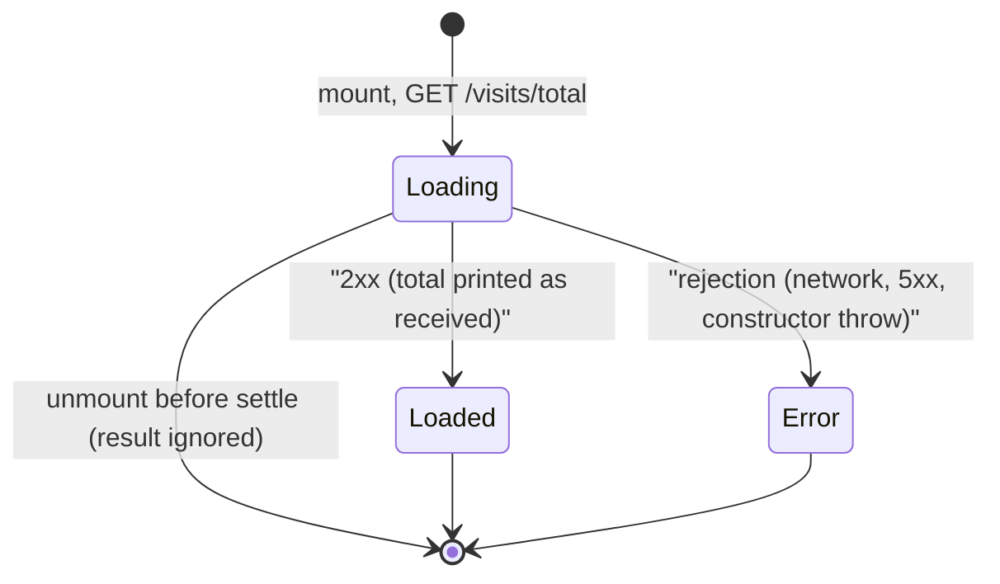
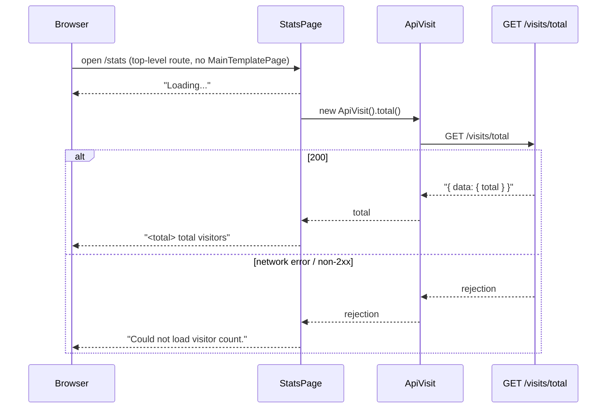

# S05 - Show the total on the hidden `/stats` page

- **Plan:** [plan.md](plan.md)
- **Type:** Slice
- **Requirements covered:** FR-11, FR-12 (the page itself changes no visit state), FR-13; acceptance criteria "Given no rows ... `/stats` shows `0 total visitors`" (page part), "Given a user opens `/stats`, then it shows `Loading...` and then `<n> total visitors`, with no nav bars, no POST is sent, and `lastVisitAt` is not changed", "Given the total request fails, when `/stats` is open, then it shows a short error text"
- **Prerequisites:** `GET /visits/total` route (public, 200, `data: { total: number }` in the `{ success, message, data }` wrapper), `ApiVisit` class (`src/api/api-visit.ts`), `visit-dtos.ts` (`src/api/dto/visit-dtos.ts`). Also uses the existing `ApiConnection.get`, `CommonResponse`, `CenteredPage` (`src/components/ui/panel.tsx`) and the CSS variables in `src/app-style.css`.
- **Creates:** `ApiVisit.total(): Promise<number>`, `VisitTotalDTO` (in `visit-dtos.ts`), `StatsPage` (`src/pages/stats-page.tsx`), top-level route `{ path: "/stats", element: <StatsPage /> }` in `appRouter`

All paths below are relative to the frontend repository `C:\Devel\growtweet-front` (branch `visitor-count`).

## 1. Goal
Opening `<frontend-host>/stats` shows one line of text, centered on the app background, with no NavBar, News or mobile nav:

1. `Loading...` while `GET /visits/total` is pending,
2. then `<n> total visitors` (for example `0 total visitors`, `1 total visitors`, `12345 total visitors`),
3. or `Could not load visitor count.` if the request fails.

No link to `/stats` exists anywhere in the UI. The page never sends `POST /visits` and never reads or writes `localStorage.lastVisitAt`.

## 2. Context
- React 18 + Vite + TypeScript (`strict`, `noUnusedLocals`, `noUnusedParameters`), react-router-dom 6 (`createBrowserRouter`), styled-components 6, axios. No test suite. `npm run lint` fails on any warning (`react-hooks`, `react-refresh/only-export-components`).
- `src/app-router.tsx` exports `appRouter = createBrowserRouter([...])`: one `/` entry with `MainTemplatePage` and its children, then the top-level entries `/edit-profile`, `/login`, `/new-account`. Top-level entries render without the main layout.
- API clients extend `ApiConnection`, have an explicit `constructor() { super(); }`, are created per call and, when they return payload data, unwrap it in a `.then((response: AxiosResponse<XxxDTO>) => response.data.data...)` (see `ApiUser.create`). `ApiConnection.get` rejects on non-2xx and network errors; on 401 it clears storage and redirects to `/login`.
- Pages are named exports `export function XxxPage()` with styled-components declared below the component (`explore-page.tsx`). Data pages load in a `useEffect(..., [])` (`feed-page.tsx`).
- `CenteredPage` (`src/components/ui/panel.tsx`) is the existing full-viewport, centered wrapper on `--color-surface-0`, used by the standalone pages.
- Code style: 4-space indent, double quotes, Allman braces for class members and top-level functions.
- `App.tsx` shows the existing pinned warm-up toast after 4 s if `GET /auth/ping` has not answered, on every route. That toast is not part of this page.

## 3. Structure

### 3.1 Files
| File | Change | Responsibility |
|------|--------|----------------|
| `src/api/dto/visit-dtos.ts` | modify | Append the `GET /visits/total` response type |
| `src/api/api-visit.ts` | modify | Add `ApiVisit.total()` |
| `src/pages/stats-page.tsx` | new | `StatsPage`: load the total and render loading / value / error |
| `src/app-router.tsx` | modify | Register the top-level `/stats` route |

### 3.2 Front API client

`src/api/dto/visit-dtos.ts`: append after the existing `DailyVisitDTO` line (do not change it or the import):

```ts
export type VisitTotalDTO = CommonResponse<{ total: number }>;
```

`src/api/api-visit.ts`:
- Extend the existing DTO import to `import { DailyVisitDTO, VisitTotalDTO } from "./dto/visit-dtos";`.
- Append this method after `register()`; the constructor and `register()` stay untouched.

```ts
    /** All-time visit count (GET /visits/total). Rejects on any non-2xx status or a network error. */
    async total() : Promise<number>
    {
        return super.get('/visits/total')
            .then((response: AxiosResponse<VisitTotalDTO>) =>
            {
                return response.data.data.total;
            });
    }
```

`total()` does not catch errors and does not validate the payload; the caller decides what a failure means.

### 3.3 Front page: `src/pages/stats-page.tsx`

```tsx
import { useEffect, useState } from "react";
import { styled } from "styled-components";
import { ApiVisit } from "../api/api-visit";
import { CenteredPage } from "../components/ui/panel";

const LOADING_TEXT = "Loading...";
const ERROR_TEXT = "Could not load visitor count.";

type StatsState =
    | { status: "loading" }
    | { status: "loaded"; total: number }
    | { status: "error" };

export function StatsPage()
{
    const [state, setState] = useState<StatsState>({ status: "loading" });

    useEffect(() => { /* see below */ }, []);

    return (
        <CenteredPage>
            <StatsText role="status">{statsText(state)}</StatsText>
        </CenteredPage>
    );
}

/** `<n> total visitors` with a plain integer (FR-13), or the loading / error text. */
function statsText(state: StatsState) : string

const StatsText = styled.p`...`;
```

Component behavior:
- Initial state `{ status: "loading" }`, so the first render already shows `Loading...`.
- The effect (dependency array `[]`) declares `let active = true;`, then runs:

  ```ts
  Promise.resolve()
      .then(() => new ApiVisit().total())
      .then((total) => { if (active) setState({ status: "loaded", total }); })
      .catch(() => { if (active) setState({ status: "error" }); });
  return () => { active = false; };
  ```

  - `new ApiVisit()` is created inside the first `.then` so that a synchronous throw from its constructor (it reads `localStorage.getItem('token')`) also ends in the error state.
  - The cleanup clears `active`, so no state is set after unmount.
- Any 2xx response moves to `"loaded"` with whatever `total` came back; the payload is not checked (approved decision). A malformed value is printed as is through `String(...)` (for example `undefined total visitors`); only a rejected request or a constructor throw leads to `"error"`.
- `statsText(state)`:
  - `"loading"` → `LOADING_TEXT`
  - `"error"` → `ERROR_TEXT`
  - `"loaded"` → `` `${String(state.total)} total visitors` ``. Use `String(...)`, never `toLocaleString`, so there is no thousands separator; the noun is fixed, never singular (FR-13).
- No toast, no `console` output, no retry button. The page does not import `ApiAuth`, does not import or call `ApiVisit.register()` and does not touch `localStorage` itself (FR-12).
- Only `StatsPage` is exported (the `react-refresh/only-export-components` rule); `statsText`, the constants, `StatsState` and `StatsText` stay module-private.

Styles (`StatsText`, declared below the component like `explore-page.tsx`):

```css
margin: 0;
font-size: var(--font-size-xl);
font-weight: var(--font-weight-semibold);
line-height: var(--line-height-tight);
color: var(--color-text);
text-align: center;
```

`CenteredPage` supplies the full-height centered layout, the `--color-surface-0` background and the mobile padding; no new layout CSS is added.

Accessibility: `role="status"` (implicit `aria-live="polite"`) makes screen readers announce the change from `Loading...` to the count or the error. No heading or landmark is added; the page is one line of text by design (RFF §6).

### 3.4 Front routing: `src/app-router.tsx`
- Add `import { StatsPage } from "./pages/stats-page";` after the existing page imports.
- Append a new top-level entry as the last element of the array passed to `createBrowserRouter`, after the `/new-account` entry:

```tsx
    {
        path: "/stats",
        element: <StatsPage />,
    },
```

It is not a child of the `/` entry, so `MainTemplatePage` (NavBar, News, mobile nav) is not rendered. No other entry changes, and no `Link`, `NavLink` or `navigate("/stats")` is added anywhere.

## 4. Logic flows



The page starts in `Loading` and settles once into `Loaded` or `Error`; it never goes back. If the component unmounts first, the `active` flag drops the late result so no state is set on an unmounted component.



## 5. Edge cases and errors
| Case | Expected behavior |
|------|-------------------|
| `total` = 0 (empty table) | `0 total visitors` |
| `total` = 1 | `1 total visitors` (no singular, FR-13) |
| `total` = 12345 or larger | `12345 total visitors` (no separator, FR-13) |
| API unreachable, timeout, 5xx | `Could not load visitor count.`; no toast or console output from the page. If `/auth/ping` also fails to answer within 4 s, the existing warm-up toast from `App.tsx` appears as on any other route; it is not caused by this page |
| 2xx with `data.total` missing, `null`, non-numeric, negative or fractional | Shown as received: `String(total)` + ` total visitors` (e.g. `undefined total visitors`); no error text (approved decision) |
| `ApiVisit` constructor throws (storage blocked) | `Could not load visitor count.`; the page still renders |
| 401 from `GET /visits/total` | Not expected (public endpoint); the existing `ApiConnection` handler would apply. No special handling |
| Slow response | `Loading...` stays until the request settles (no client timeout, as in `ApiConnection.get`) |
| User leaves `/stats` before the response | The late result is ignored (`active` flag) |
| `/stats/` or `/STATS` | Matched by react-router's default matching and renders the same page |
| Opening `/stats` (directly or by typing the URL) | No `POST /visits`; `lastVisitAt` not read or written by this page (FR-12) |
| Logged in or anonymous | Same page; login state is not read |

## 6. Tests

### 6.1 Automated
The frontend has no test suite, and the RFF lists automated tests as a non-goal, so this step adds none. Build and lint gates:

| Test file | Test name | Given / When / Then | Proves |
|-----------|-----------|---------------------|--------|
| whole frontend | type check + build | When `npm run build` runs in `growtweet-front`, then `tsc` and `vite build` succeed | New signatures, the discriminated union and the router entry compile under `strict` / `noUnusedLocals` |
| whole frontend | lint | When `npm run lint` runs, then there are 0 errors and 0 warnings | Hook deps, `only-export-components`, no unused imports |

Run with: `npm run build && npm run lint` (in `C:\Devel\growtweet-front`)

### 6.2 Manual
Environment: backend running locally on port 3333 with `GET /visits/total` available (`.env` with a reachable `DATABASE_URL`); `npm run dev` in `growtweet-front`; Chrome DevTools open on Network (filter `visits`) and Application → Local Storage.

- Given an empty `daily_visits` table (`DELETE FROM daily_visits;`) and Network throttling "Slow 3G", when `/stats` is opened, then `Loading...` shows first and then `0 total visitors`. (FR-11; AC "no rows → `0 total visitors`")
- Given `INSERT INTO daily_visits (date, count) VALUES ('2026-11-01', 1);` only, when `/stats` is reloaded, then `1 total visitors` is shown. (FR-13 no singular)
- Given rows summing to 12345 (e.g. `UPDATE daily_visits SET count = 12345;` with one row), when `/stats` is reloaded, then `12345 total visitors` is shown with no separator, also with the browser language set to a locale that uses separators (e.g. `pt-BR`). (FR-13)
- Given the backend is running, when DevTools → Network request blocking with the pattern `*/visits/total` is enabled and `/stats` is reloaded, then `Could not load visitor count.` is shown, no toast appears, and the console has no error logged by the page (the browser's own "blocked" line is fine). (FR-11 error state; AC "total request fails")
- Given the backend is stopped, when `/stats` is opened, then `Could not load visitor count.` is shown once the request fails (the existing warm-up toast may also appear after 4 s, as on any route). (FR-11 error state)
- Given any state, when `/stats` is opened on desktop and at a 375 px wide viewport, then only the centered line of text is visible on the app background: no NavBar, no News panel, no mobile bottom nav, no horizontal scroll. (FR-11)
- Given no `lastVisitAt` in Local Storage, when `/stats` is opened directly and reloaded twice, then Network shows `GET /visits/total` but no `POST /visits`, and `lastVisitAt` stays absent. Given `lastVisitAt` = some value, when `/stats` is reloaded, then the value is unchanged. (FR-12; AC "no POST is sent, `lastVisitAt` is not changed")
- Given a logged-in session and an anonymous session, when `/stats` is opened in each, then both show the same total. (Public page)
- Given `/stats/` and `/STATS`, when each is opened, then the same page renders. (§5)
- Given a screen reader (or DevTools → Accessibility pane), when the page settles, then the text node is exposed with role `status`. (§3.3 accessibility)
- Given the app, when browsing every page (home, explore, profile, replies, login, new account, edit profile), then no link or button leads to `/stats`. (FR-11 hidden page; see also §6.3)

### 6.3 Static checks
Run in `C:\Devel\growtweet-front`:
- `grep -rn "/stats" src --include=*.tsx` → exactly two lines, both in `src/app-router.tsx`: the `import { StatsPage } from "./pages/stats-page";` line and the `path: "/stats",` line (no `Link`/`navigate` to it anywhere). The literal in `src/visit-tracker.ts` is a `.ts` file and is not matched.
- `grep -n "VisitTotalDTO" src/api/dto/visit-dtos.ts src/api/api-visit.ts` → the type line, the import and the `.then` annotation.
- `grep -n "toLocaleString\|lastVisitAt\|register\|localStorage" src/pages/stats-page.tsx` → no output (FR-12, FR-13).
- `git diff src/app-router.tsx` → only the `StatsPage` import and the new top-level entry.

## 7. Implementation order
1. Append `VisitTotalDTO` to `visit-dtos.ts` and add `ApiVisit.total()`; `npm run build` passes.
2. Add `src/pages/stats-page.tsx`; `npm run build` and `npm run lint` pass.
3. Register the `/stats` route in `app-router.tsx`; run the build, the lint, the static checks and all manual checks.

## 8. Out of scope
- No change to `ApiVisit.register()`, `DailyVisitDTO`, `ApiConnection`, `App.tsx`, the visit tracker, `MainTemplatePage` or any existing route, page or component.
- No link, menu item or redirect to `/stats`.
- No per-day data, chart or call to `GET /visits` on the page (RFF non-goal: per-day data in the UI).
- No retry button, polling, caching or toast.
- No backend changes.
- No automated tests (RFF non-goal).

## 9. Design notes
- **Reuse `CenteredPage`:** the existing standalone-page wrapper already gives the full-height centered layout on the app background, so the page adds only one text rule (DRY, keep it simple).
- **Discriminated union state** instead of `total: number | null` plus an `error` flag: it makes the three states mutually exclusive, and `statsText` maps each one to exactly one string.
- **`ApiVisit.total()` unwraps the payload** (`Promise<number>`), following `ApiUser.create`; the page does not need the wrapper. It stays thin (no catch, no validation) so the HTTP client has one responsibility.
- **No payload validation (approved decision):** a 2xx always shows the value that came back. The backend contract guarantees an integer `total`, so a check would only guard against a backend bug; the trade-off is that such a bug would render, e.g., `undefined total visitors` instead of the error text.
- **`String(total)`, not `toLocaleString`:** FR-13 forbids separators regardless of the browser locale.
- **`active` flag on unmount:** avoids setting state after the user leaves the page during a slow request; cheaper than an `AbortController`, which `ApiConnection.get` would need extra config for.
- **Route appended last:** a top-level entry keeps the page outside `MainTemplatePage`; appending avoids touching existing entries. Order does not affect matching in react-router 6 (ranked routes).
- **Warm-up toast kept (approved decision):** the existing warm-up toast in `App.tsx` can still appear on `/stats` when the backend is cold; it is left as is.
